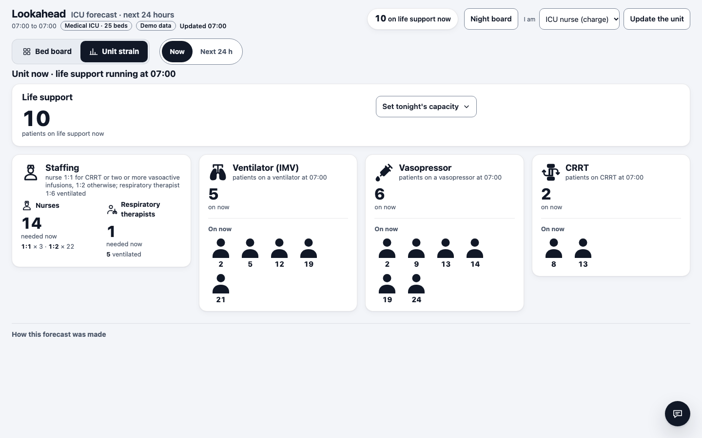
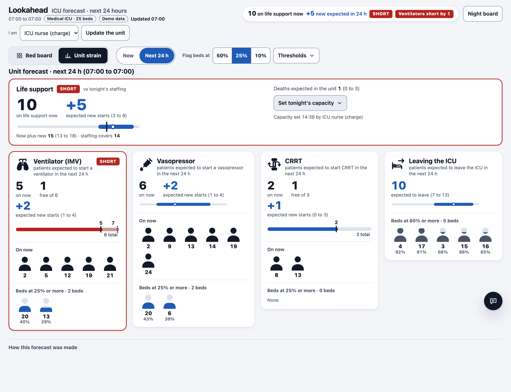
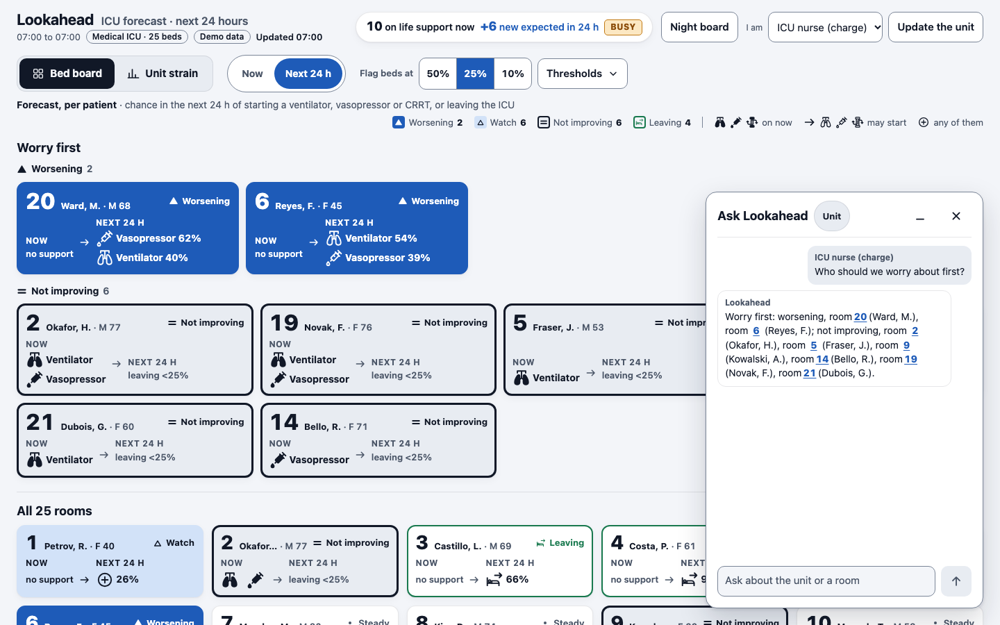
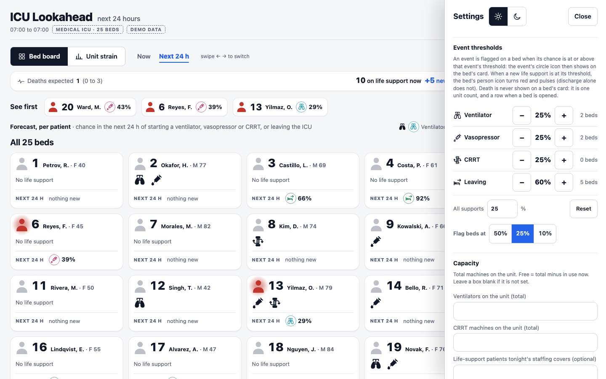
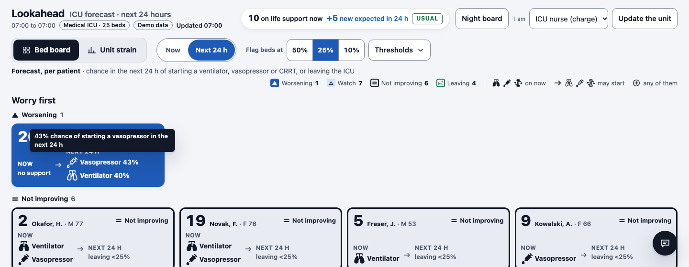
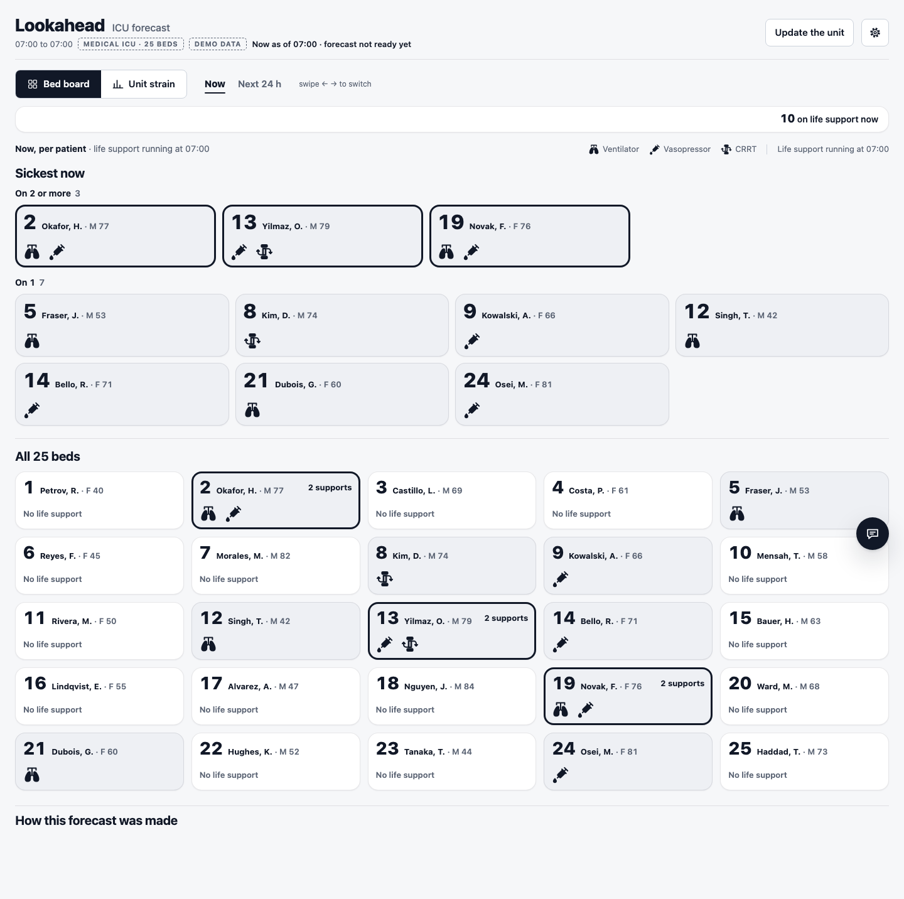
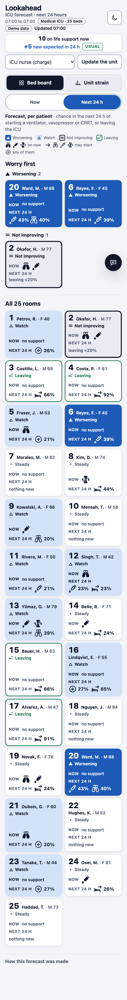
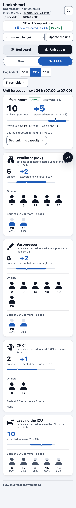
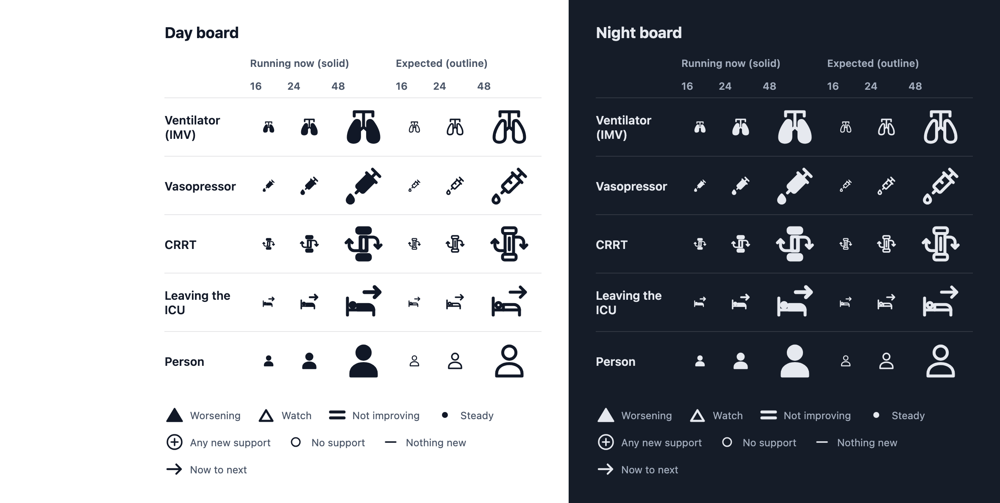

# Lookahead: ICU forecast for the next 24 hours

**Taking this over? Start with [`HANDOFF.md`](HANDOFF.md).**

*The next 24 hours, in one place.* The command-center board for **Lookahead** (backend working name ICU-Twin), team7's project at the CIQ × NVIDIA Local AI Hackathon (Chicago, Nov 14–15, 2026).

**What Lookahead does.** For 07:00 morning rounds, it forecasts every patient who has been in the ICU at least 24 hours: a small transformer trained on local hardware (MIMIC-IV in CLIF format) reads each patient's history in one forward pass, a probe gives the probability of five events in the next 24 hours, and the patients are added up into a **strain panel**: how many patients are on life support now (IMV, vasopressor, CRRT, running at 07:00), how many more are expected, and one word that compares that with tonight's staffing or a typical day. Each bed shows what is running now, what may start, and one status. Pharmacy, respiratory therapy, the ICU team and the bed manager each read their own line first. NVIDIA Nemotron 3 Nano, running locally, answers questions from the counts. Everything runs on two Lenovo ThinkStation PGX (NVIDIA GB10) nodes through CIQ Fuzzball; patient data never leaves them.

**Why it matters: the rural ICU.** A small or rural hospital has one ICU, a few ventilators and CRRT machines, no data-science team and no cloud contract for patient data. When the unit runs short, the nearest help is a transfer hours away, so knowing at 07:00 what the next 24 hours will need is worth the most there. Lookahead is sized for that hospital: one 25-bed unit, two desk-size local machines, nothing in the cloud, and patient data that never leaves the building. The model is trained and run on local hardware; it is trained on MIMIC-IV in CLIF format, and a hospital with CLIF-format data can run the same pipeline on its own records.

**Two models.** We trained one: the patient model. It reads each chart as a sequence of events; at 07:00 we take the output of its last layer for each patient, and five small classifiers turn that into the five predictions clinicians asked for (ventilator, vasopressor, CRRT, leaving the ICU, death). The chat uses NVIDIA Nemotron 3 Nano as it is; it answers from the forecast and predicts nothing itself. Both run on the two local machines.

**This repo** is the full app except model training: the board page (`mockups/`), the backend that serves and feeds it (`backend/`: board server, dispatcher, chat agent, forecast builders, Fuzzball workflows), and the team's docs and diagrams (`docs/`). Model training lives in [vaishvikc/ICU-Twin](https://github.com/vaishvikc/ICU-Twin).

## The board

Synthetic data in the mockup ([`mockups/command-center.html`](mockups/command-center.html)); the same page reads the live API when `app/board.py` serves it. Two tabs. **Bed board**: every bed reads now, then the next 24 hours (solid icons for the ventilator, vasopressor or CRRT running at 07:00, an arrow, outline icons for what may start with its chance, "3 in 10"), with one status per bed (Worsening, Watch, Not improving, Leaving, Steady) and a "Worry first" rail on top. **Unit strain**: patients on life support now, how many more are expected, one word against tonight's staffing or a typical day, and a card per support with the beds behind each count. A room opens its own page; "Update the unit" and "Update this room" start a forecast; "Ask" opens a chat panel beside the board. The cluster cards, bed figures and range bars come from Dema's (deetherese) design on the `alternative` branch.


| Bed board, Now: current sickness only | Unit strain, Next 24 h |
|---|---|
|  |  |

| Unit strain, Now | Capacity set: flagged beds outnumber free ventilators |
|---|---|
|  |  |

| Room page | Ask Lookahead (chat widget) |
|---|---|
|  |  |

| "Flag beds at" and Thresholds | A legend on hover | Forecast not ready yet |
|---|---|---|
|  |  |  |

| Phone, bed board | Phone, unit strain | Night board | Wall screen, 1920 px |
|---|---|---|---|
|  |  |  |  |

Icon family: 

## How it runs

Nothing is hosted in the cloud. The real app runs on two local Lenovo PGX machines under Fuzzball; a laptop can run a demo copy with synthetic data. The team's guide, with every figure, the endpoint table and the run commands: [`docs/ARCHITECTURE.md`](docs/ARCHITECTURE.md).


More figures: [frontend](docs/diagrams/frontend.png), [backend](docs/diagrams/backend.png), [how to run it on the cluster](docs/diagrams/workflow.png), [API map](docs/diagrams/api.png), [the 07:00 run](docs/diagrams/sequence.png).

## Who uses it

Every role's morning, step by step: [`docs/USER_JOURNEY.md`](docs/USER_JOURNEY.md).

## Run it locally

```bash
python3 -m http.server 8000   # from this repo, then open:
# http://localhost:8000/mockups/command-center.html   (#night, #room=20, #role=pharmacy, #fast, #synthetic)
```

## Start here

| Read | For |
|---|---|
| [`HANDOFF.md`](HANDOFF.md) | where things stand, who owns what, how to run it, what to do next on the cluster |
| [`docs/ARCHITECTURE.md`](docs/ARCHITECTURE.md) | the team's guide: what runs where, tech stack, architecture and API figures, how the board starts a Fuzzball job, how to run it locally and on the cluster |
| [`docs/USER_JOURNEY.md`](docs/USER_JOURNEY.md) | the 07:00 morning: charge nurse, physician, pharmacy, respiratory therapy, bed manager, midday rerun, night shift, judges |
| [`docs/FRONTEND_SPEC.md`](docs/FRONTEND_SPEC.md) | screens, data contract (`forecast.json`, `rooms.json`, `/api/runs`, `/api/rerun`, `/api/capacity`, `/api/ask`), states, rules |
| [`docs/DECISIONS.md`](docs/DECISIONS.md) | team decisions (ICU-only cohort, 07:00 rounds, probe scoring, five predictions, per-room views on the stage ward only, auditability, the two triggers) |
| [`mockups/command-center.html`](mockups/command-center.html) | the reviewed mockup: open it in a browser (synthetic data, works offline; `#night`, `#room=20` and `#role=pharmacy` deep links) |
| [`DESIGN.md`](DESIGN.md), [`PRODUCT.md`](PRODUCT.md) | the visual system and product context the Impeccable skill reads |
| [`examples/forecast.json`](examples/forecast.json), [`examples/rooms.json`](examples/rooms.json) | a synthetic forecast and stage-ward rooms in the exact shape the board receives |

## Working on the design with Impeccable

This repo is set up for the [Impeccable](https://impeccable.style) design skill: `PRODUCT.md`, `DESIGN.md`, `.impeccable/design.json` and the mockup's direction contract in `.impeccable/surfaces/`. In Claude Code run `/impeccable critique mockups/command-center.html`, `/impeccable polish ...` or `/impeccable shape <new screen>`; it loads this context automatically. The 2026-11-14 Lookahead build passed `impeccable detect` with 0 anti-patterns.

## Rules

- Synthetic or open demo data only in this repo. No patient data, credentials, internal IP addresses or personal paths.
- Every number shows its range (8 in 10 likely outcomes); chances are whole percentages ("23%"); status is never shown by colour alone; decision support, never a treatment recommendation.
