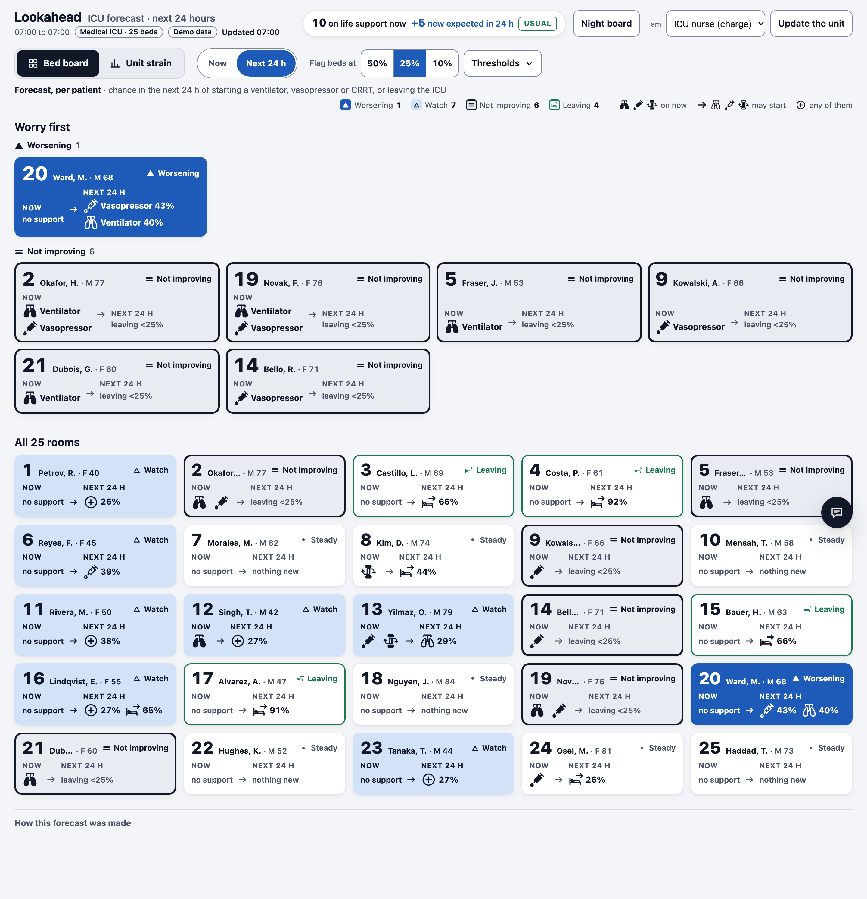
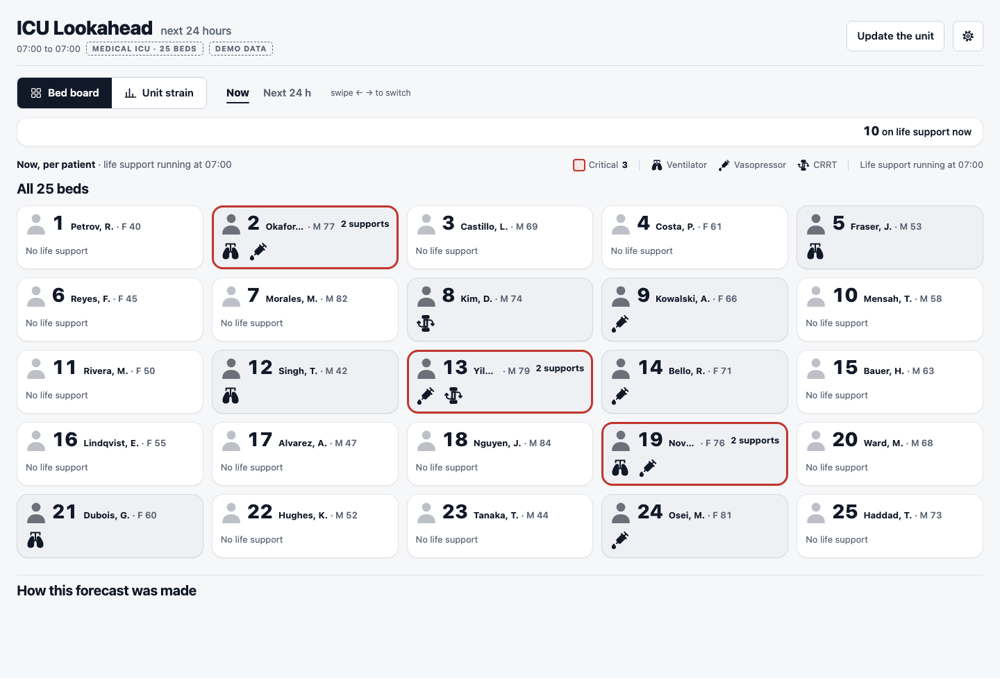

# Lookahead: the ICU's next 24 hours, on two local machines

A bed board that tells a small ICU at 07:00 what the next 24 hours will need. Team7, CIQ × NVIDIA × Lenovo Local AI Hackathon, Chicago, Nov 14–15, 2026.

**Project page with every figure and screenshot:** https://sajor2000.github.io/icustrainciq/ · **Taking this over?** Start with [`HANDOFF.md`](HANDOFF.md).

## The problem

A small or rural hospital has one ICU, a few ventilators and dialysis machines, no data-science team and no cloud contract for patient data. When the unit runs short, the nearest help is a transfer hours away. The team learns it is short when it already is.

Lookahead answers one question each morning: who is on life support now, who is likely to need it by tomorrow, and does the unit have the machines and staff for that. It runs in the building, so patient data never leaves.

> **Key.** ICU: the intensive care unit. Life support: a machine or drug that does the work of a failing organ. Ventilator: breathes for the patient. Vasopressor: a drug drip that holds blood pressure up. CRRT: continuous dialysis, for failed kidneys.

## How we used the stack


- **Lenovo ThinkStation PGX × 2, each with an NVIDIA GB10.** The whole product runs on these two desk-size machines. Nothing is in the cloud.
- **CIQ Fuzzball 4.3.** Workflows fit the classifiers, stage the unit and run each forecast. Services keep the board server, the dispatcher and the chat model up. Volumes hold the patient data, the model and the results. The board's "Update the unit" button starts a Fuzzball job.
- **NVIDIA Nemotron 3 Nano on vLLM.** It answers questions in the chat. We use it as it is; we did not train it. It reads the forecast and predicts nothing.
- **Our patient model.** We trained it on the two machines, across both GPUs, on MIMIC-IV in CLIF format. It runs in the forecast job on the second GPU.

Two models, two jobs: ours knows ICU data and makes the forecast; NVIDIA's knows language and explains it.

## What we did


- **Trained a patient model** that reads a chart as a sequence of events. At 07:00 it reads each patient once; we keep its last layer.
- **Fitted five small classifiers** on that layer: ventilator, vasopressor, CRRT, leaving the ICU, death, each as a chance for the next 24 hours.
- **Built the board**: every bed shows now, then the next 24 hours, with one status; "Worry first" lists the beds to see first; Unit strain adds the patients up with a range and compares them with tonight's machines and staff.
- **Built the services**: a board server, a dispatcher that starts the 07:00 run and the on-request runs, and a chat agent that answers from the forecast through tools.
- **Wrote the Fuzzball workflows**: setup (`t7-code`, `t7-fit`, `t7-ward`), services (`t7-twin`) and the forecast (`t7-forecast`), as ready-to-run files in `backend/fuzzball/ready/`. The six files on the run path passed `fuzzball workflow validate` against the live cluster, with a stand-in for the one volume still to create.
- **Tested it**: 264 backend tests pass (`cd backend && uv run --extra dev --extra model pytest -q`).
- **Where it stands**: the demo patients and the trained model are on the cluster. Nothing of ours has run end to end on the cluster yet; the board runs today on a laptop with made-up data. The run list is in [`HANDOFF.md`](HANDOFF.md).

## The board



| Now: life support running at 07:00 | Unit strain: the unit added up |
|---|---|
|  |  |


## Run it

```bash
python3 -m http.server 8000        # then open http://localhost:8000/mockups/command-center.html#synthetic
cd backend && uv run --extra dev --extra model pytest -q
cd backend && uv run python app/board.py --forecast ../examples/forecast.json --static ../mockups/command-center.html --port 8080
```

## More

- **Project page:** https://sajor2000.github.io/icustrainciq/ (how it predicts, all screenshots, architecture, run steps)
- **[`HANDOFF.md`](HANDOFF.md):** where things stand, who owns what, the cluster run list
- **[`docs/ARCHITECTURE.md`](docs/ARCHITECTURE.md):** what runs where, tech stack, endpoints
- **[`docs/submission/`](docs/submission/):** the one-sheet and the five-minute demo script
- **[`backend/README.md`](backend/README.md):** the backend, module by module
- **Design system:** [`DESIGN.md`](DESIGN.md) is the one source for the board, the figures and the project page
- **Model training:** [vaishvikc/ICU-Twin](https://github.com/vaishvikc/ICU-Twin)
- **Team and credits:** team7. Cluster cards, bed figures, the flag-line toggle and the capacity model are Dema's (deetherese) design.

Demo data only: the mockup uses made-up patients, and names on the board are fictional. Lookahead is a research prototype, not a medical device; it supports decisions and recommends no treatment.
