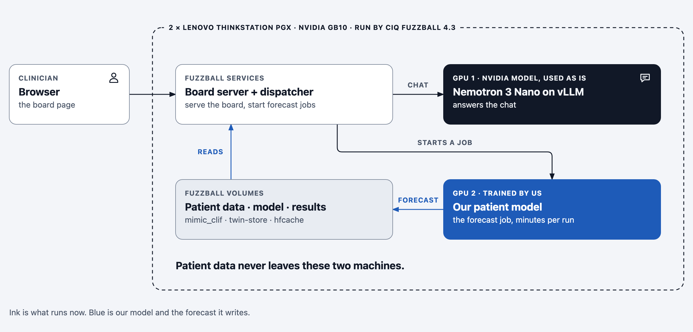
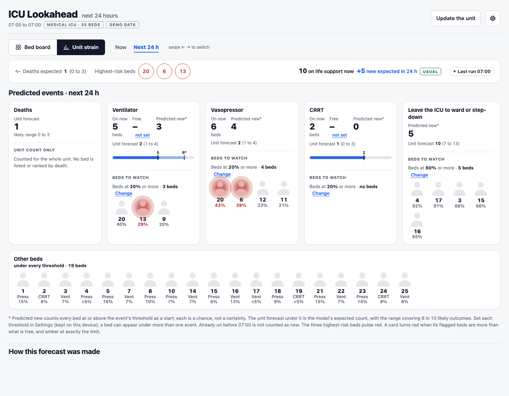
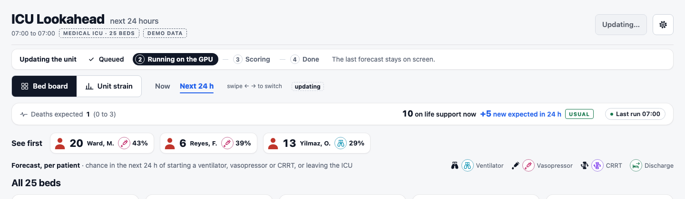

# ICU Lookahead: see the next 24 hours of your ICU, on machines you own

A bed board that tells a small ICU at 07:00 what the next 24 hours will need. Team7, CIQ × NVIDIA × Lenovo Local AI Hackathon, Chicago, Nov 14–15, 2026.

> **The demo runs from the team's ICU-Twin repo ([github.com/vaishvikc/ICU-Twin](https://github.com/vaishvikc/ICU-Twin)). Do not run `launch.sh` from this repo; its `ready/` files would overwrite the team's code on the shared volume.**

## For the team

| Read | For |
|---|---|
| [`docs/ICU_TWIN_DELTA.md`](docs/ICU_TWIN_DELTA.md) | **The morning decision:** every change in this repo against ICU-Twin, its risk to the running demo, and what to port before or after the demo |
| [`docs/UI_REVIEW_FOR_DEMA.md`](docs/UI_REVIEW_FOR_DEMA.md) | Each change to Dema's board page, with before and after pictures and how to undo it |
| [`HANDOFF.md`](HANDOFF.md) | Where things stand, who owns what, the morning steps |

**Project page with every figure and screenshot:** https://sajor2000.github.io/icustrainciq/ · **Taking this over?** Start with [`HANDOFF.md`](HANDOFF.md).

## The problem

A small or rural hospital has one ICU, a few ventilators and dialysis machines, no data-science team and no cloud contract for patient data. When the unit runs short, the nearest help is a transfer hours away. The team learns it is short when it already is.

ICU Lookahead answers one question each morning: who is on life support now, who is likely to need it by tomorrow, and does the unit have the machines and staff for that. It runs in the building, so patient data never leaves.

> **Key.** ICU: the intensive care unit. Life support: a machine or drug that does the work of a failing organ. Ventilator: breathes for the patient. Vasopressor: a drug drip that holds blood pressure up. CRRT: continuous dialysis, for failed kidneys.

## How we used the stack



- **Lenovo ThinkStation PGX × 2, each with an NVIDIA GB10.** The whole product runs on these two desk-size machines. Nothing is in the cloud.
- **CIQ Fuzzball 4.3.** Workflows publish the code (`t7-code`), stage the unit (`t7-ward`) and run each forecast (`t7-forecast`). Services keep the board server, the dispatcher and the chat model up (`t7-twin`). Three volumes: `mimic_clif` (patient data and the trained model, only read), `hfcache` (Nemotron weights) and `twin-store` (code, the staged unit, results). The board's "Update the unit" button starts a Fuzzball job.
- **NVIDIA Nemotron 3 Nano on vLLM.** It answers questions in the chat. We use it as it is; we did not train it. It reads the forecast and predicts nothing.
- **Our patient model.** We trained it on the two machines, across both GPUs, on MIMIC-IV in CLIF format. It runs in the forecast job on one GPU while Nemotron holds the other.

Two models, two jobs: ours knows ICU data and makes the forecast; NVIDIA's knows language and explains it.

## What we did


- **Trained a patient model** that reads a chart as a sequence of events. At 07:00 it reads each patient once; we keep its last layer.
- **Fitted five small classifiers** on that layer: ventilator, vasopressor, CRRT, leaving the ICU, death, each as a chance for the next 24 hours. Training fits them once, beside the model (job 4), and the forecast applies the saved file; it never refits. The cohort is ICU patients, cut 24 hours after ICU arrival.
- **Built the board** (Dema's final design): every bed shows life support now, then the next 24 hours. A "See first" row names the three beds most likely to need a new life support. An event shows in a circle with its chance once it reaches the threshold set in Settings, and the bed's person icon turns red and pulses when a new life support reaches it. Death never marks a bed: it is one count for the unit, and a row when a bed is opened. A bed opens a pop-up with its five chances and the last 12 hours of vital signs. Unit strain has one card per event, with the unit forecast and its range, against the ventilators and CRRT machines the unit has. Now and Next 24 h switch with a swipe. "Update the unit" shows the job's progress (Queued, Running on the GPU, Scoring, Done). Names on the tiles are generated and fictional.
- **Built the services**: a board server, a dispatcher that starts the 07:00 run and the on-request runs, and a chat agent that answers from the forecast through tools.
- **Wrote the Fuzzball workflows**: publish the code (`t7-code`), stage the unit (`t7-ward`), the forecast (`t7-forecast`: a check, one model pass on one GPU, scoring) and the services (`t7-twin`), as ready-to-run files in `backend/fuzzball/ready/`. `t7-fit` stays only as a fallback for when training's job 4 has not run. One script, `backend/scripts/launch.sh`, runs what is needed and prints the board's link.
- **Tested it**: 459 backend tests pass: 431 with `cd backend && uv run --extra dev --extra model pytest -q`, and 28 more that drive the page in a real browser (`uv run --extra dev --extra model --with playwright python -m pytest -q`).
- **Where it stands**: it ran end to end on the two Lenovo machines under Fuzzball with one launch script (the team's run on 2026-11-14, from ICU-Twin). The demo patients and the trained model are on the cluster. The steps, what each leaves on the cluster and the failures already met there are in the [runbook](backend/docs/RUNBOOK.md). The board also runs on a laptop with made-up data.

## How well it predicts

On held-out patients (cut at ICU arrival + 24 h, event in the next 24 h): AUROC **0.93** for death, **0.88** for leaving to step-down, **0.88** for CRRT start, **0.80** for leaving to a ward, **0.78** for ventilator start and **0.77** for vasopressor start. Full table with ranges, AUPRC and Brier: [`docs/RESULTS.md`](docs/RESULTS.md).


## The board


| Now: life support running at 07:00 | Unit strain: one card per event, against the unit's machines |
|---|---|
|  |  |




## Where the patient data lives

The patient tables stay on Fuzzball volumes inside the two machines. The clinician's browser gets the unit counts and one entry per room: the five chances, the last events the model read and 12 hours of vital signs. The chat model gets tool results only. GitHub holds code only.


## Run it

```bash
# 1. The board with made-up data (own terminal; it keeps running)
python3 -m http.server 8000        # open http://localhost:8000/mockups/command-center.html#synthetic

# 2. Backend tests, from the repo root
(cd backend && uv run --extra dev --extra model pytest -q)

# 3. The board server on example data (own terminal; it keeps running)
(cd backend && uv run python app/board.py --forecast ../examples/forecast.json --static ../mockups/command-center.html --port 8080)

# 4. On the cluster: run these from the team's ICU-Twin checkout, NOT from this repo (see the notice at the top).
#    The same script lives here in backend/scripts/ for reference (backend/docs/RUNBOOK.md).
bash scripts/launch.sh             # start what is missing, wait for the board, print its HTTPS link
bash scripts/launch.sh --forecast  # run a fresh forecast first
bash scripts/launch.sh --link      # print the link of the running board
bash scripts/launch.sh --restart   # stop t7-twin and start it again
bash scripts/launch.sh --all       # publish code, stage the unit, forecast, then the board
```

## More

- **Project page:** https://sajor2000.github.io/icustrainciq/ (how it predicts, all screenshots, architecture, run steps)
- **[`HANDOFF.md`](HANDOFF.md):** where things stand, who owns what, the morning steps
- **[`docs/ICU_TWIN_DELTA.md`](docs/ICU_TWIN_DELTA.md):** this repo against ICU-Twin, and what to port
- **[`docs/RESULTS.md`](docs/RESULTS.md):** held-out results per task
- **[`docs/ARCHITECTURE.md`](docs/ARCHITECTURE.md):** what runs where, tech stack, endpoints
- **[`docs/submission/`](docs/submission/):** the one-sheet and the five-minute demo script
- **[`backend/README.md`](backend/README.md):** the backend, module by module
- **Design system:** [`DESIGN.md`](DESIGN.md) is the one source for the board, the figures and the project page
- **Model training:** [vaishvikc/ICU-Twin](https://github.com/vaishvikc/ICU-Twin)
- **Runbook:** [`backend/docs/RUNBOOK.md`](backend/docs/RUNBOOK.md): set up, publish code and relaunch the board on the cluster (`backend/scripts/launch.sh`)

## Team 7 - CLIF

Five people. Roles and institutions in the second column are as listed by the [CLIF Consortium](https://clif-icu.com/team).

| Name | CLIF Consortium | On this project |
|---|---|---|
| J.C. Rojas, MD | Founding Vice-Chair, Steering Committee · Rush University | Product, board and chat, Fuzzball workflows, docs ([sajor2000](https://github.com/sajor2000)) |
| Kaveri Chhikara, MS | Vice-chair for Software Development, Steering Committee · UChicago Medicine | Forecast pipeline on the cluster, dispatcher, launch script and runbook |
| Vaishvik Chaudhari, MS | Vice-chair and Technical Lead, Steering Committee · Rush University | The patient model: tokenizer, training, the ICU + 24 h cut, probes ([vaishvikc/ICU-Twin](https://github.com/vaishvikc/ICU-Twin)) |
| Dema Therese, MS | UChicago Medicine | Board design: person icon at the Settings thresholds, event cards, bed pop-up with 12-hour vitals, settings panel, Now/Next swipe, the capacity model |
| Zewei ('Whiskey') Liao, MS | UChicago Medicine | Team member |

Demo data only: the mockup uses made-up patients, and names on the board are fictional. ICU Lookahead is a research prototype, not a medical device; it supports decisions and recommends no treatment.
