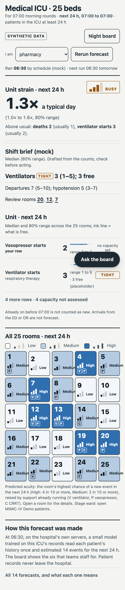
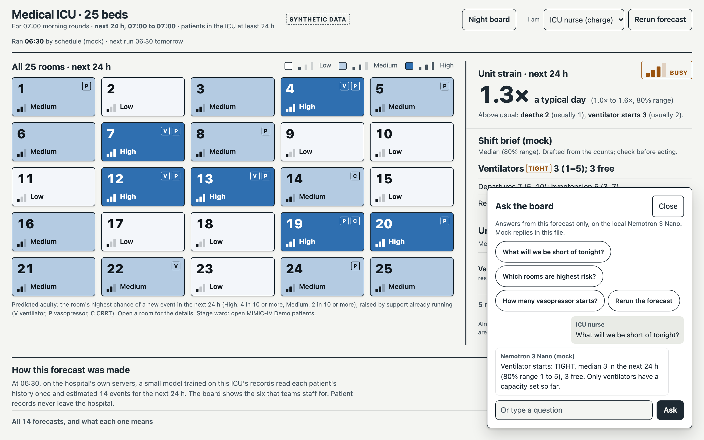
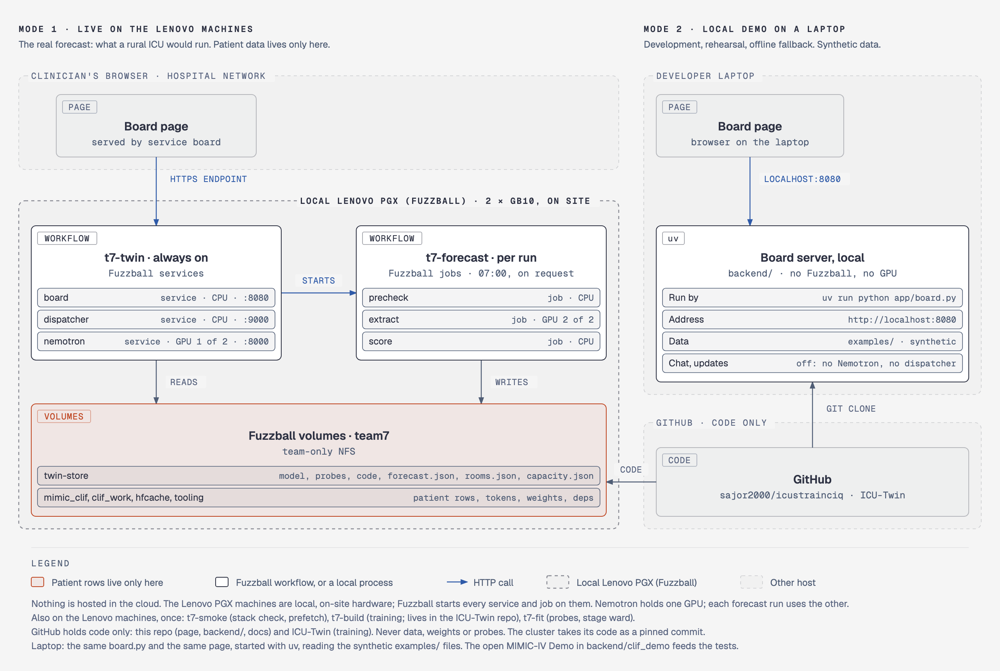
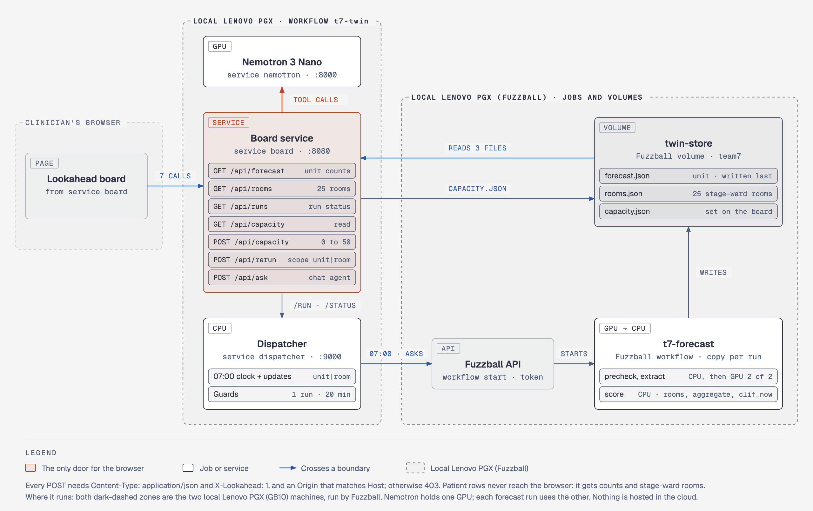
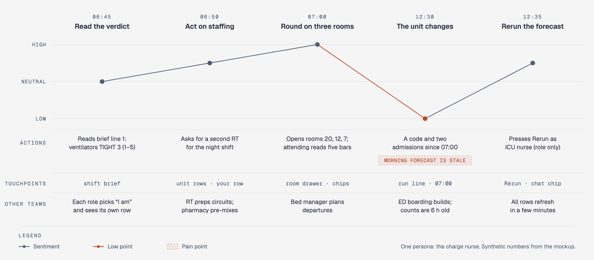

# ICU strain board (frontend)

The command-center board for **ICU-Twin**, team7's project at the CIQ × NVIDIA Local AI Hackathon (Chicago, Nov 14–15, 2026).

**What ICU-Twin does.** For 07:00 morning rounds, it forecasts every patient who has been in the ICU at least 24 hours: a small transformer trained on the unit's own CLIF data reads each patient's history in one forward pass, a probe gives the probability of six events in the next 24 hours, and the patients are added up into **unit strain** with an 80% range. The ICU team of nurses and physicians reviews every count; pharmacy prepares vasopressors, respiratory therapy prepares ventilators, the ICU team watches CRRT starts, hypotension and deaths, and the bed manager plans patients leaving the ICU. NVIDIA Nemotron 3 Nano, running locally, answers questions from the counts. Everything runs on two Lenovo ThinkStation PGX (NVIDIA GB10) nodes through CIQ Fuzzball; patient data never leaves them.

**This repo** is the frontend: what the board must do, for whom, and how it should look. The backend (model, Fuzzball workflows, the board server `app/board.py`, the forecast dispatcher) is in [vaishvikc/ICU-Twin](https://github.com/vaishvikc/ICU-Twin).

## The board

Synthetic data, the reviewed mockup ([`mockups/command-center.html`](mockups/command-center.html)). All 25 rooms on one screen, each coded by predicted acuity (Low / Medium / High) three ways at once: a signal-strength glyph, the tile shade and the word. On the right: the unit strain index ("1.3× a typical day"), a three-line shift brief, and each team's row with its median and 80% range. A room opens its own page; "Ask the board" is a chat widget that opens on demand.

| Day board, 1440 px | Night board, 1440 px |
|---|---|
|  |  |

| Room page (room 20) | Phone, pharmacy |
|---|---|
|  |  |

| Ask the board (chat widget open) |
|---|
|  |

## How it runs





Fuzzball runs the real forecast on the team's two GB10 nodes and serves the live board; this laptop runs an offline demo; Vercel can host a public preview with synthetic numbers. Patient rows stay in the team7 volumes. Steps for the team, the data boundary and the hosting plan: [`docs/ARCHITECTURE.md`](docs/ARCHITECTURE.md).

## The charge nurse's day



Every role's journey: [`docs/USER_JOURNEY.md`](docs/USER_JOURNEY.md).

## Run it locally

```bash
python3 -m http.server 8000   # from this repo, then open:
# http://localhost:8000/mockups/command-center.html   (#night, #room=20, #role=pharmacy)
```

## Start here

| Read | For |
|---|---|
| [`docs/NAMING_AND_WORDING.md`](docs/NAMING_AND_WORDING.md) | product name candidates and the words to use on the board (plain language, human factors) |
| [`docs/ARCHITECTURE.md`](docs/ARCHITECTURE.md) | architecture, data boundary, how the team runs it on Fuzzball, hosting plan (local demo, Fuzzball, Vercel), diagrams |
| [`docs/USER_JOURNEY.md`](docs/USER_JOURNEY.md) | the 07:00 morning: charge nurse, physician, pharmacy, respiratory therapy, bed manager, midday rerun, night shift, judges |
| [`docs/INTEGRATION.md`](docs/INTEGRATION.md) | how the board talks to the cluster: the five-operation interface, model output end to end, the chat path, request rules, what the Fuzzball team must provide |
| [`docs/FRONTEND_PLAN.md`](docs/FRONTEND_PLAN.md) | the build plan: decisions, milestones M0 to freeze, `rooms.json` contract, tasks by lane, checks, risks |
| [`docs/FRONTEND_SPEC.md`](docs/FRONTEND_SPEC.md) | screens, data contract (`forecast.json`, `/api/ask`, `/api/rerun`), states, rules |
| [`docs/DECISIONS.md`](docs/DECISIONS.md) | team decisions (ICU-only cohort, 07:00 rounds, probe scoring, six tasks, per-room views on the stage ward only, auditability, the two triggers) |
| [`mockups/command-center.html`](mockups/command-center.html) | the reviewed mockup: open it in a browser (synthetic data, works offline; `#night`, `#room=20` and `#role=pharmacy` deep links) |
| [`DESIGN.md`](DESIGN.md), [`PRODUCT.md`](PRODUCT.md) | the visual system and product context the Impeccable skill reads |
| [`examples/forecast.json`](examples/forecast.json) | a synthetic forecast in the exact shape the board receives |

## Working on the design with Impeccable

This repo is set up for the [Impeccable](https://impeccable.style) design skill: `PRODUCT.md`, `DESIGN.md`, `.impeccable/design.json` and the mockup's direction contract in `.impeccable/surfaces/`. In Claude Code run `/impeccable critique mockups/command-center.html`, `/impeccable polish ...` or `/impeccable shape <new screen>`; it loads this context automatically. The mockup passed Impeccable's finish review (verdict: ship).

## Rules

- Synthetic or open demo data only in this repo. No patient data, credentials, internal IP addresses or personal paths.
- Every number shows its 80% range; status is never shown by colour alone; decision support, never a treatment recommendation.
