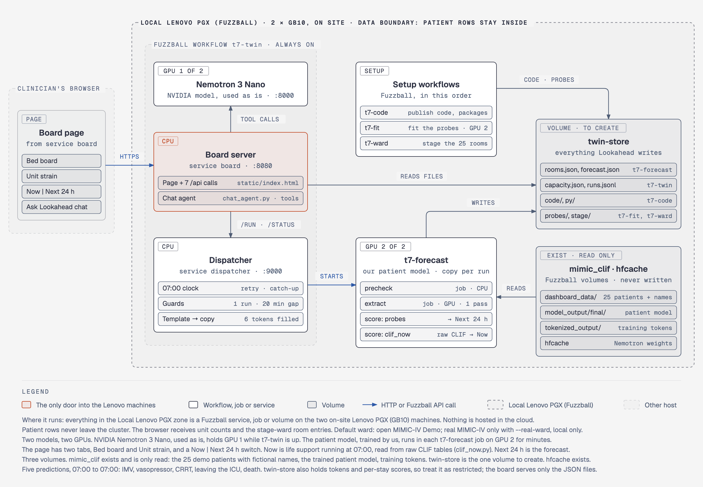

# Lookahead backend

Everything the Lookahead board needs at run time, copied from the ICU-Twin repo
(branch `t7/integrate-lookahead`). Model training stays in ICU-Twin.

| Folder | What it is |
|---|---|
| `app/board.py` | Board server: serves the page and `/api/forecast`, `/api/rooms`, `/api/runs`, `/api/capacity`, `/api/rerun`, `/api/ask` |
| `app/dispatcher.py` | Starts forecast runs on Fuzzball: 07:00 daily (with retry and catch-up), unit or one room on request |
| `app/chat_agent.py` | "Ask about this forecast" agent (Nemotron 3 Nano via vLLM, tool calling) |
| `app/rooms.py`, `app/aggregate.py` | Build `rooms.json` (per room) and `forecast.json` (unit counts with ranges) |
| `app/clif_now.py` | Life support running at the 07:00 cut, read from raw CLIF tables |
| `app/stage_ward.py`, `app/ward_check.py` | The ward's room map (25 open-demo stays, or exactly the ids of a file with `--ward-ids`); is a ward's CLIF folder ready |
| `app/fake_names.py` | Made-up names for the room tiles (`--names`); never real names |
| `scripts/run_cohort.py` | A given ward end to end on a laptop: no GPU, no cluster, no model needed |
| `scripts/render_fz.py` | Fills a Fuzzfile template's tokens; refuses one left unfilled |
| `scripts/make_ready.sh` | Writes `fuzzball/ready/`: every workflow rendered for the final cohort, with the code commit and its checksum |
| `app/static/index.html` | The page the board serves (copy of `mockups/command-center.html`) |
| `icutwin/` | Tokenizer, model definition and probe scoring used to score patients |
| `fuzzball/` | Workflow templates (Fuzzball 4.3): `t7-code` (publishes this folder to the cluster), `t7-fit`, `t7-ward`, `t7-forecast`, `t7-twin`; `ready/` holds them rendered for the final cohort. `t7-smoke` is no longer on the run path |
| `clif_demo/` | Open MIMIC-IV Demo in CLIF format (the default stage ward) |
| `docs/` | `CONTRACT.md` (JSON shapes), `LIVE_DEMO.md` (runbook), `FUZZBALL_VALIDATION.md` (checked against the live cluster, storage map), `FUZZBALL_TEST_PLAN.md` (first run on the cluster), `COMPUTE_PLAN.md`, `FUZZBALL_43_REVIEW.md`, `CHAT_AGENT.md` |

## Architecture

What runs where, the API map and how the board starts a Fuzzball job: [`../docs/ARCHITECTURE.md`](../docs/ARCHITECTURE.md).



## Run locally

```
uv run --extra dev --extra model pytest -q
uv run python app/board.py --forecast ../examples/forecast.json --static ../mockups/command-center.html --port 8080
```

Open http://localhost:8080. Every POST needs `Content-Type: application/json` and `X-Lookahead: 1`.

## Run on the cluster

The steps and their state: `../HANDOFF.md` "To run it on the cluster". The cohort is already on the cluster (`mimic_clif:/dashboard_data/`, only read); the model is read at `mimic_clif:/model_output/final/`; everything written goes to one volume, `twin-store`. Start the files in `fuzzball/ready/`; do not render by hand.

## Run the final cohort on a laptop

The 25 demo patients are real MIMIC-IV stays in CLIF format. They live in `data/local/unit25/` (git ignores `backend/data/`) and never leave the machine. Two commands, from `backend/`:

```
uv run --extra model python scripts/run_cohort.py data/local/unit25 --ward-ids data/local/unit25/dashboard_patients_unit25.parquet --real-ward --names data/local/unit25/name.parquet
uv run python app/board.py --forecast data/local/out/forecast.json --host 127.0.0.1 --port 8080
```

The first builds the room map, tokenizes, winnows at the cut, reads what is running at the cut from raw CLIF, and writes `rooms.json` and `forecast.json` to `data/local/out/`. The second serves the page on loopback only: open http://127.0.0.1:8080. On real patients always pass `--host 127.0.0.1`.

- No model yet: the files say `"forecast_state": "pending-model"`. The Now side is real; every prediction is null (`docs/CONTRACT.md`).
- With a model: add `--model <mdl dir> --probes <probes dir>`. Needs the trained weights and the probes from `t7-fit`.
- Later in the stay: `--demo-clock-hours 6` moves every patient six hours on, on that patient's own clock. `--cut-table 0,24,48,72` prints how many rooms remain and how many are on each support at each clock (counts only, writes nothing).
- The open demo instead of the cohort: `python app/stage_ward.py clif_demo --out /tmp/ids.csv`, then `scripts/run_cohort.py clif_demo --ward-ids /tmp/ids.csv --names fake --out /tmp/out --work /tmp/work`.

Every script prints counts only: never a row, an id, a date of the data or a name.

Real patient data, model weights and probes are never stored in this repo.
