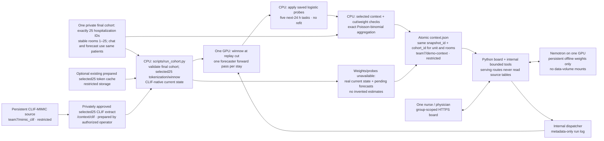

# Lookahead: selected-25 research demo

This is the actual app's backend on isolated branch `t7/ui-nemotron-chatbot`.
Run local commands below from `backend/`. The workflow alignment record names
the current-app base and the reviewed frontend fingerprint for Whiskey's handoff.

This drop-in package connects one ICU nurse or physician to a 25-room research
replay. One private final cohort selects exactly 25 real MIMIC-IV
hospitalizations for both chat and forecasting. The current Claude Code cohort
pipeline supplies CLIF-native current state and, when trained weights and saved
probes are ready, five forecasts. Otherwise it explicitly publishes pending
forecasts with no estimates. The board and its internal tools read one atomic
`context.json`; Nemotron answers from those tools. Chat does not scan MIMIC or run
the clinical forecaster for every message; Nemotron does infer for each answer.

**Current boundary:** the cluster is frozen. These files are prepared and checked
locally only. No volume has been provisioned, no package uploaded, and no Fuzzball
validation or workflow started for this change. Deployment, GPU startup, runtime
tool calling and the private cohort still require operator verification after
the freeze is lifted. This remains a retrospective research prototype.

## Architecture



The five tasks are new invasive ventilation, vasopressor initiation, CRRT
initiation, ICU departure, and in-hospital death. Ward and step-down heads support
the ICU departure task. Intervals for aggregate counts use exact Poisson-binomial
calculation under the model's across-stay independence assumption. The package
does not sample Monte Carlo futures or refit probes.

Current state comes from CLIF support/ADT observations at each stay's own cut,
independent of whether a forecast is ready. The shared 07:00 display clock aligns
the replay presentation; it does not claim these historical patients occupied
one ICU on the same calendar date. Missing model weights or saved probes leave
the same 25 rooms visible with pending forecasts and no probability estimates.

Both GPUs have a clear role: `t7-lookahead-chat` keeps Nemotron on one; each
`t7-lookahead-forecast` update briefly requests the other. A room refresh reruns
the bounded cohort of 25 and republishes the whole snapshot so room and unit
views remain consistent. Ordinary chat reads the existing snapshot and consumes
no forecast GPU allocation.

The existing [Fuzzball review](../../docs/archive/FUZZBALL_43_REVIEW.md) (archived) and
[compute plan](COMPUTE_PLAN.md) govern placement: forecast extraction requests
8 cores/48 GB and one GPU without `exclusive`, leaving room for the board and
dispatcher on that node (11 cores/54 GB combined). Nemotron may keep the demo's
separate exclusive node. GPU quantity 1 already prevents GPU sharing; a forecast
must not request whole-node exclusivity.

## Storage prerequisites

An authorized operator must verify these existing volumes and restricted access
before deployment. The Fuzzfiles reference volumes; they do not create them.

| Mount | Persistent volume | Contents and permitted readers |
|---|---|---|
| `/store` | `team7/twin-store` | Code at `/store/code`, forecaster at `/store/model/mdl-icutwin`, saved probes in one file, `/store/probes/probe-mdl-icutwin.joblib`, with `probe-mdl-icutwin.meta.json` (the weights checksum) beside it, staged CLI `/store/bin/fuzzball`. Code/model/probes and approved aggregate counts only; no roster, room rows or clinical context. |
| `/models` | `team7/hfcache` | Nemotron weights. This is the LLM service's only persistent mount. |
| `/context` | `team7/demo-context` | **Restricted:** private `cohort_ids.csv`, approved selected-25 CLIF extract `clif/`, generated `stage_ward.csv`/`roster.csv`, selected-25 `tokenized_output/`, room projections, `context.json`, metadata run log and rendered workflow files. Board routes read the approved context and metadata, never source tables; this is a shared restricted volume, not a per-directory filesystem isolation boundary. |
| `/rows` | `team7/clif_work` | **Restricted:** existing prepared token/features/scores source, if used by an authorized operator to prepare the selected cache. Never mounted in the new runtime definitions. |
| `/clif` | `team7/mimic_clif` | **Restricted:** persistent source CLIF, historically `/clif/clif`. An authorized operator prepares the approved selected-25 extract under `/context/clif`; the new runtime definitions do not mount the full source volume. |

The persistent local Nemotron snapshot was verified previously at
`/models/nemotron-3-nano-fp8/9bee19446c0dfd01f356e10979d225b2a6621944`
(38 ordinary files, approximately 32.7 GB). It survives workflow shutdown. This
change does not recheck those cluster files. The pinned vLLM image is
`docker://nvcr.io/nvidia/vllm:25.12.post1-py3`; startup uses that local path with
`HF_HUB_OFFLINE=1`, `TRANSFORMERS_OFFLINE=1`, and
`HF_HOME=/models/runtime-hf`. The conservative starting context length is 8192
tokens with one active sequence; no GPU acceptance or larger context length is
claimed. Tool calling uses `qwen3_coder`; the client disables thinking per request.
The service uses `--no-enable-log-requests` and `--no-enable-log-outputs`, documented
in the [vLLM 0.12 serve CLI](https://docs.vllm.ai/en/v0.12.0/cli/serve/). Actual
compatibility with the pinned container still requires the deferred runtime check.

The private input `/context/cohort_ids.csv` has a `hospitalization_id` header and
exactly 25 unique IDs. `scripts/run_cohort.py` assigns stable rooms and writes
the same private map as `stage_ward.csv` and a strict two-column `roster.csv`
(`room,hospitalization_id`). Those maps drive both chat and forecasting. Inspect
them privately within restricted storage; never paste them into agent context,
copy them into this public repository, or include them in the archive.

## Build a local code-only archive

Run from this checkout with Python 3.12. This command only creates an archive in
an unsynced local directory; it makes no network or Fuzzball call:

```bash
python3 scripts/package_lookahead_demo.py --out /private/tmp/lookahead-demo.tar.gz \
  --frontend-file "$APPROVED_FRONTEND_HTML"
tar -tzf /private/tmp/lookahead-demo.tar.gz
```

Choose a new output name if the archive exists. The package includes explicit
source/configuration paths, the three new Fuzzfiles, this playbook and a SHA-256 file
manifest at `code/LOOKAHEAD_PACKAGE.json`. It rejects source symlinks and synced
output destinations, and excludes roster/context files, Parquet/CSV files,
weights, credentials, `.env`, `.git`, `.venv` and `clif_demo`. No clinical source
or pretrained weights are copied. The archive expands to `code/`, suitable for
an operator's reviewed code promotion under `/store`. Preserve any existing code
directory before promoting the new package; do not overlay a live process's code.

For the current Claude Code design, set `APPROVED_FRONTEND_HTML` to this checkout's
reviewed `app/static/index.html`: the current source mockup with the approved
pending/unknown and atomic-transport fixes. `--frontend-file` stages those exact
HTML bytes as the archive's `app/static/index.html` without editing either source
checkout. The manifest records the chosen frontend's SHA-256 and size. Without
this optional override, packaging uses this checkout's existing frontend; do not
mistake that for verification that the current Claude design was selected. HTML
under data directories and symlinked source paths are refused. Runtime API calls
remain same-origin on the board's port 8080; dispatcher 9000 and Nemotron 8000
remain internal.

The archive includes the current cohort helper `scripts/run_cohort.py`,
`app/clif_now.py`, `app/ward_check.py`, `uv.lock`, and the existing
`requirements/t7-model.in` / `t7-model.txt` model dependency pins, copied unchanged
from the current source's `backend/requirements/`. No new
dependency versions are invented and no SGLang/Monte Carlo requirement set is
needed. Dependencies must already be installed at `/store/py` on `twin-store`
(`t7-code.fz` puts them there; the separate `tooling` volume is no longer used);
the workflows do not install packages at startup.

The [workflow alignment record](CLAUDE_WORKFLOW_ALIGNMENT.md) records the current
Claude Code design and the supplied API, hosting, trigger and architecture PDF
contracts. It is included in the archive. The `/context/clif` extract and
`/context/cohort_ids.csv` paths below are proposed operator prerequisites, not
claims that those files or volumes have been uploaded or prepared.

## Prepare and publish privately after the freeze

The following are future **operator commands inside the restricted runtime**, not
commands for an agent to execute against clinical data. Paths must be confirmed
privately. First place the chosen final ID list at `/context/cohort_ids.csv` and
an approved CLIF extract containing those patients at `/context/clif`. Do not
point initial tokenization at the full MIMIC root. `REPLAY_CUT` must be an
explicit ISO timestamp with UTC offset for the presentation clock. Confirm the
source-data timezone separately from the board's presentation timezone.

```bash
umask 077
export PYTHONPATH=/store/py:/store/code
REPLAY_CUT=2026-11-14T07:00:00-06:00

python /store/code/scripts/run_cohort.py /context/clif \
  --ward-ids /context/cohort_ids.csv --real-ward --work /context --out /context \
  --context-out /context/context.json --cut-time "$REPLAY_CUT" \
  --demo-clock-hours 0 --tz America/Chicago --data-tz US/Eastern --names fake
```

With no `--model` or `--probes`, this existing cohort pipeline runs on CPU:
selected-25 tokenization, winnowing and CLIF-native current state, then an atomic
real-source context with pending forecasts. `t7-lookahead-prepare.fz` authors this
one-time operation as a CPU-only workflow. Run it once after privately confirming
the final cohort; restarting chat does not rerun preparation or replace a valid
ready forecast with a pending snapshot. It neither fits probes nor infers missing
risks. The optional existing-cache argument is
`--tokenized-output /context/tokenized_output`; it must refer to this same cohort.

Once trained weights and saved probes are ready, the forecast template winnows
the same selected cache, extracts last hidden states on one GPU, then invokes:

```bash
python /store/code/scripts/run_cohort.py /context/clif \
  --ward-ids /context/cohort_ids.csv --real-ward \
  --tokenized-output /context/tokenized_output --work /context --out /context \
  --model /store/model/mdl-icutwin --probes /store/probes/probe-mdl-icutwin.joblib --no-extract \
  --context-out /context/context.json --cut-time "$REPLAY_CUT" \
  --demo-clock-hours 0 --tz America/Chicago --data-tz US/Eastern --names fake
```

`--no-extract` prevents a second CPU forward pass: it applies saved logistic
probes to the GPU features, verifies model/cut consistency, and publishes both
views from the same cohort. The features must have been extracted with the
weights now in `--model`: `icutwin-extract` writes the weights digest beside
each features file (`features-<split>-<model>.meta.json`), and a file with
another digest, or with none (made before the digest was recorded), is refused
with "run icutwin-extract again". The winnow step logs stay counts only
(`--counts-only`): for 25 stays an outcome rate is a clinical value. The workflow never refits probes. If model/probe
prerequisites are unavailable, keep the existing real current-state snapshot and
its explicit pending forecast state; launch the GPU forecast only when ready.

The current app's fictional-name module, unit label and machine-capacity behavior
are retained. The dispatcher supplies the same private ID file/CLIF path and
`--names fake` to the rendered update; an existing `/context/capacity.json` is
passed through to the ready snapshot. Names are invented display labels, never
source patient names.

The display clock is a **research replay**. Historical stays retain individual
cuts at ICU arrival + 24 h + the demo offset. A shared replay timestamp does not
assert simultaneous calendar-time occupancy. A cut that drops a selected stay
can leave an ended historical stay as `present:false` in its stable room slot.
That room remains part of the fixed roster and receives no invented forecast.
Invalid inputs fail publication; the last complete context remains available.

## Runtime verification after the freeze

Lane 2 should perform the live Fuzzball 4.3.1 validation and launch only when
cluster operations are authorized again. Retain the legacy `t7-twin.fz` and
`t7-forecast.fz`; the new names are explicit alternatives, not an in-place change
to existing running workflows.

1. Confirm volumes, code, timezone dependencies, staged CLI, the private final
   cohort and approved selected CLIF extract. Validate/run `t7-lookahead-prepare`
   once to create the selected cache and pending real context. Trained weights and
   saved probes are prerequisites for later GPU forecasting, not CPU current
   state. Verify access controls and retention for source volumes, endpoint proxy
   logs and service logs.
2. Render `t7-lookahead-forecast.fz` through the dispatcher, or with
   `scripts/render_fz.py`, which fills every token (`@SCOPE@`, `@ROOM@`,
   `@HOURS@`, `@CUT@`, `@WARD_FLAG@`, `@CLIF_DIR@`, `@WARD_IDS@`, `@NAMES@`) in
   a private copy. `@CUT@` is the replay cut (the last 07:00 at dispatch plus
   `@HOURS@`, with its UTC offset): it is fixed when the run is started and the
   jobs never read the clock, so a run that crosses 07:00 keeps its day. Validate
   that rendered file and `t7-lookahead-chat.fz` with the live CLI. Offline YAML
   parsing is not Fuzzball server validation.
3. Start the chat workflow with the name `t7-lookahead-chat`. Services retain DNS
   names `board`, `nemotron` and `dispatcher`. The board exposes only its
   group-scoped HTTPS endpoint; dispatcher and Nemotron have no external endpoint.
   Connect with `fuzzball workflow connect --name board --endpoint web WORKFLOW_ID`,
   using the returned workflow ID.
   The board starts with `--behind-proxy --require-real-data`: proxied HTTPS
   browser POSTs are supported, and missing/open-demo contexts are refused.
4. Confirm the board reports the real-MIMIC local-only research replay and 25
   rooms. Verify unit and rooms carry matching snapshot/cohort identifiers. A
   missing or inconsistent context must show an unavailable state.
5. Check `/v1/models` privately, then ask a short unit question and a room
   question. Confirm genuine model tool calls, bounded tool results, matching
   snapshot citations, and no unsupported treatment recommendation. The board
   remains readable while Nemotron is loading or its API is temporarily
   unavailable within a live workflow. A fatal Nemotron service exit can fail
   the whole Fuzzball workflow and requires an operator restart.
6. Request one authorized refresh, observe the single-GPU forecast complete, and
   confirm unit and room snapshot identifiers change together. If it stalls,
   retain the last valid real snapshot or show its explicit pending/unavailable
   state. This deployment does not substitute open-demo patients or estimates.

The dispatcher is internal and has permission to start workflows through its
injected workflow token. Role selection is advisory, not authentication; this is
one demonstration user, not a multiuser clinical authorization system. The
dispatcher still enforces one running forecast and the update cooldown.

## Prompt and data boundary

The rule is docs/DECISIONS.md D6 as revised by D19: the default ward is the open
MIMIC-IV Demo; real MIMIC-IV room views are allowed on the local cluster only,
in an explicit real-ward mode. The code enforces it:

- A real MIMIC-IV ward is **counts-only by default**. A board started without
  `--real-ward` or `--require-real-data` returns no room records for it
  (`/api/rooms` and the context carry `"rooms": [], "counts_only": true`, and
  `check_first` is empty) and the chat's room tool refuses. Unit counts stay.
- This deployment starts the board with `--require-real-data`, which is
  real-ward mode. Then, and only then, room context may reach Nemotron, which
  runs on the same local machines: **only for a room the request is about** (the
  open room, or a room number in the question), never for a unit question.
- What is sent for that room: the room number, an invented display name, age,
  sex, observed support, the five probabilities and up to the last 12 hours of
  event kinds. **No stay or hospitalization id, no dates and no clock fields**;
  the payload is checked for identifier keys and source dates before it is sent.
- Questions, answers, prompts and tool payloads are never logged.

Nemotron has no filesystem access to the roster, token cache or CLIF source.
The board retrieves bounded context through Python tools. Real per-room context
is sensitive even without hospitalization IDs: keep the HTTPS endpoint and every
snapshot on restricted cluster storage. Never send it to external agent tools,
Jev, public recordings, object-cache egress, Dropbox or this code archive.

vLLM request logging is disabled. Application, reverse-proxy and infrastructure
logs must exclude request/prompt bodies, tool payloads and responses; use only
timestamp, status, duration, scope/room and workflow/snapshot metadata. Protect
those metadata logs too. Do not enable shell tracing, dump environment variables,
print exception tracebacks containing clinical values, or inspect data rows
through an agent. Live privacy and runtime checks remain an operator obligation.
