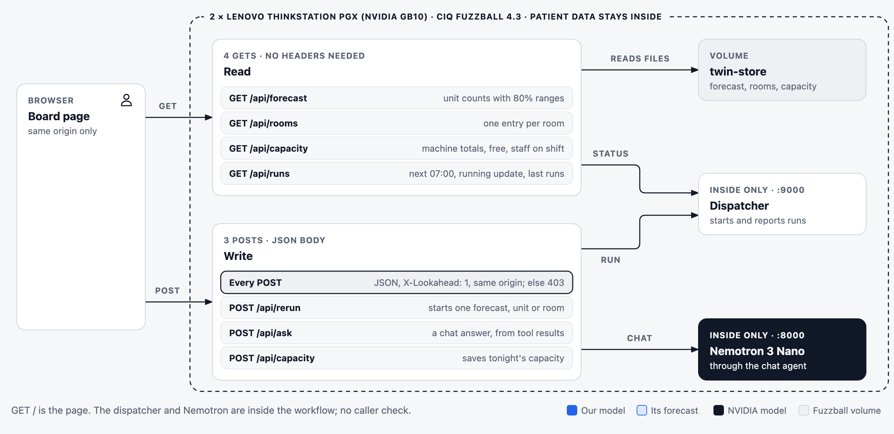
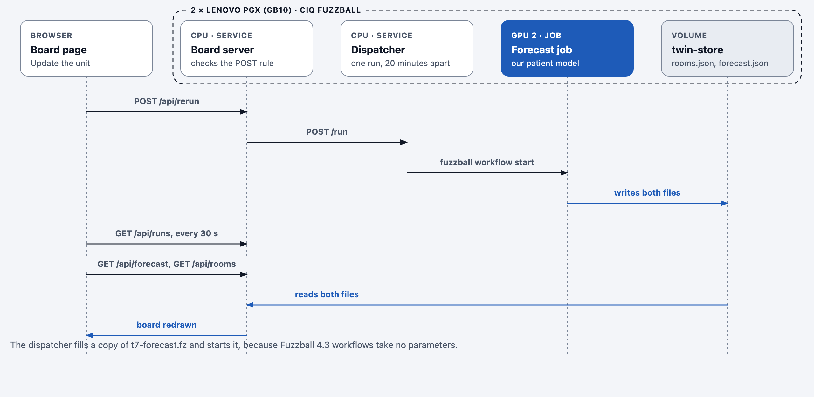
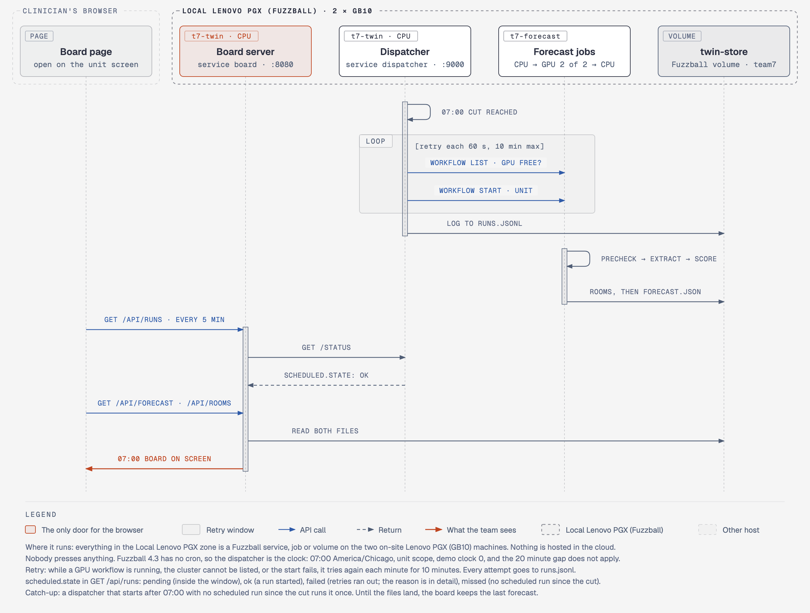
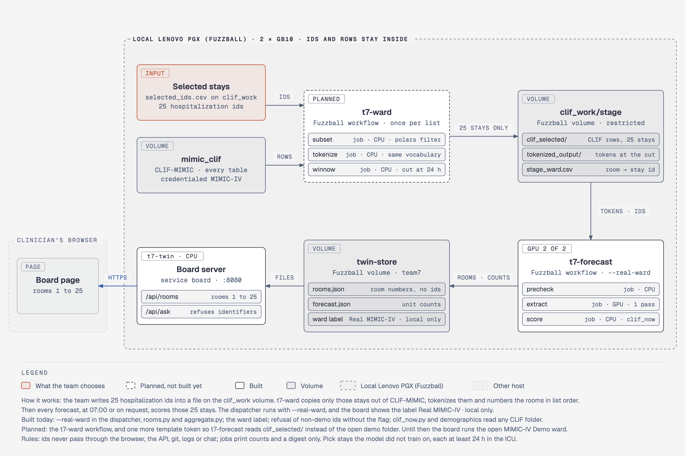
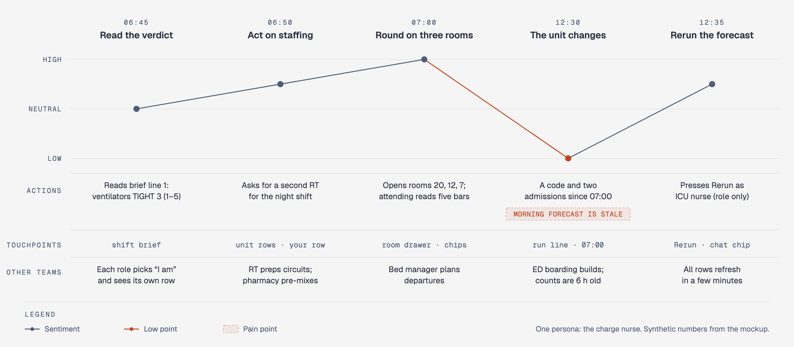

# Architecture: the team's guide

How Lookahead is built, where each part runs, and how to start it. Every figure has an editable HTML source next to its PNG in [`diagrams/`](diagrams/). JSON shapes: [`../backend/docs/CONTRACT.md`](../backend/docs/CONTRACT.md). Runbook: [`../backend/docs/LIVE_DEMO.md`](../backend/docs/LIVE_DEMO.md).

**Nothing is hosted in the cloud.** The real app runs on two local Lenovo PGX machines, on site, and Fuzzball starts every part of it. A developer laptop can run a demo copy with synthetic data. GitHub holds code only.

This is the rural-ICU case: a hospital with one unit and no cloud contract can run the whole product on two desk-size machines it owns.

## What runs where


"Local Lenovo PGX (Fuzzball)" means the two on-site GB10 machines. "Developer laptop" is a separate place. Fuzzball places CPU work on either machine; each machine has one GPU.

| Component | Machine | Run by | Port / URL | Data it can see |
|---|---|---|---|---|
| Board page | Clinician's browser, hospital network | served by the board server | the board's HTTPS endpoint | unit counts, room entries (room numbers only) |
| Board server (`app/board.py`), with the chat agent | Local Lenovo PGX, CPU | Fuzzball workflow `t7-twin`, service `board` | 8080; team-scoped HTTPS endpoint `web` | `forecast.json`, `rooms.json`, `capacity.json` |
| Dispatcher (`app/dispatcher.py`) | Local Lenovo PGX, CPU | `t7-twin`, service `dispatcher` | 9000, inside the workflow only | run log, workflow list; no patient data |
| Nemotron 3 Nano (vLLM) | Local Lenovo PGX, GPU 1 of 2, held | `t7-twin`, service `nemotron` | 8000, inside the workflow only | what the chat tools return: counts and room entries |
| Forecast run | Local Lenovo PGX, CPU then GPU 2 of 2 then CPU | Fuzzball workflow `t7-forecast`, jobs `precheck`, `extract`, `score` | none | stage-ward tokens, CLIF rows, model, probes |
| One-time workflows | Local Lenovo PGX, one or both GPUs | Fuzzball workflows `t7-smoke`, `t7-build` (ICU-Twin repo), `t7-fit` | none | training rows and tokens |
| Volumes `twin-store`, `clif_work`, `mimic_clif`, `hfcache`, `tooling` | Fuzzball storage for team7 | Fuzzball volumes | mounted into jobs and services | patient rows live only in `mimic_clif` and `clif_work` |
| Local demo | Developer laptop | `uv run python app/board.py` | `http://localhost:8080` | synthetic `examples/` files |
| Code | GitHub | `sajor2000/icustrainciq` (page, `backend/`, docs); ICU-Twin (training) | github.com | code only; never data, weights or probes |

The demo has one user at a time. There is no login and no user id. `role` is a label on the log and the answer.

## Tech stack

| Layer | Technology | Version or pin | Why |
|---|---|---|---|
| Page | one HTML file, plain JavaScript and CSS, inline SVG icons | no build step, no third-party scripts | opens offline; the board server sends it as is |
| Board server, dispatcher | Python standard library `http.server` | Python 3.12 (`python:3.12-slim`) | nothing to install inside the service |
| Chat | NVIDIA Nemotron 3 Nano 30B FP8 on vLLM, tool calling | `nvcr.io/nvidia/vllm:25.12.post1-py3`; model commit `9bee1944…` | answers come from tool results; runs on the local GPU |
| Patient model | `icutwin` decoder, Gemma 4 text layers; one forward pass, then logistic probes | `transformers` 5.23.0, `scikit-learn` 1.9.1, `nvcr.io/nvidia/pytorch:25.11-py3` | one pass per patient takes minutes on one GPU |
| Data | CLIF 2.1 tables (MIMIC-IV in CLIF format), parquet | `clifpy` 2.1 or later, `polars` 2.1.0, `pyarrow` 26.0.1 | one table format for every site |
| Orchestration | Fuzzball workflows on 2 Lenovo PGX (GB10) | Fuzzball 4.3.1 | starts services and jobs, shares the two GPUs |
| Packaging | `uv`; hash-locked requirements for the cluster | `backend/uv.lock`, `backend/requirements/t7-*.txt` | the same versions on every run |
| Tests | `pytest`, `ruff` | `dev` extra in `backend/pyproject.toml` | guards and JSON shapes are tested without a cluster |

## 1. Technical architecture


The browser talks to one service, the board server. The board server reads three files from `twin-store`, asks Nemotron through the chat agent, and asks the dispatcher to start or report runs. The dispatcher starts `t7-forecast`. Patient rows stay inside the dashed zone. Source: [`diagrams/architecture.html`](diagrams/architecture.html).

## 2. API map



| Call | Body | Returns or starts |
|---|---|---|
| `GET /` | | the page (`app/static/index.html`) |
| `GET /api/forecast` | | `forecast.json`: five predictions as unit counts with 80% ranges |
| `GET /api/rooms` | | `rooms.json`: one entry per stage-ward room |
| `GET /api/runs` | | dispatcher status: next 07:00, `scheduled.state`, running update, last runs, demo clock |
| `GET /api/capacity` | | `life_support_patients`, `vents_free`, `updated_at` |
| `POST /api/rerun` | `{role, scope: "unit" or "room", room?}` | starts one forecast run; `{started, name}` or `{started: false, reason}` |
| `POST /api/capacity` | `{life_support_patients, vents_free?, role}` | saves `capacity.json`; whole numbers 0 to 50 |
| `POST /api/ask` | `{question, role, room?, seen_made_at?}` | `{answer, made_at, trace?}` |

Every POST needs `Content-Type: application/json` and `X-Lookahead: 1`. If the browser sends an `Origin` header, it must match `Host`. Anything else gets 403. The dispatcher has two internal endpoints, `GET /status` and `POST /run`; only the board server and its chat agent call them. Source: [`diagrams/api.html`](diagrams/api.html).

## 3. How the board starts a Fuzzball job



1. The user presses "Update the unit". The page sends `POST /api/rerun`.
2. The board server checks the POST rule and passes the request to the dispatcher (`POST /run`).
3. The dispatcher checks its guards: one forecast at a time, 20 minutes between updates of the same scope.
4. Fuzzball 4.3 has no workflow parameters. The dispatcher fills `@SCOPE@`, `@ROOM@`, `@HOURS@` and `@WARD_FLAG@` in `t7-forecast.fz` and runs `fuzzball workflow start` on the copy.
5. Three jobs run: `precheck` (CPU), `extract` (GPU: winnow at the cut, one forward pass), `score` (CPU: probes, `rooms.py`, `aggregate.py`, `clif_now.py`).
6. `score` writes `rooms.json`, then `forecast.json`. Each file is written whole.
7. The page polls `/api/runs` every 30 seconds during a run. When `made_at` changes it reloads and redraws.

Room variant: `{scope: "room", room: 12}` rewrites that one room in `rooms.json`. It is refused until a whole-unit run exists. Source: [`diagrams/trigger.html`](diagrams/trigger.html).

## 4. The 07:00 run



The dispatcher is the clock. At 07:00 (America/Chicago) it starts a unit run by itself. If a GPU workflow is running, or the start fails, it tries again each minute for 10 minutes. A dispatcher that starts after 07:00 with no run since the cut runs it once. Source: [`diagrams/sequence.html`](diagrams/sequence.html).

## 5. Setup, daily run and run states


`GET /api/runs` reports the 07:00 run in `scheduled.state`: `pending`, `ok`, `failed` or `missed`. Check it after 07:15. Source: [`diagrams/lifecycle.html`](diagrams/lifecycle.html).

## 6. How the pieces connect


The same parts as figure 1, with the seven calls and the three files written out. Source: [`diagrams/connection.html`](diagrams/connection.html).

## 7. Demo ward from CLIF-MIMIC (design)



The team picks 25 hospitalization ids for the demo. This is how the backend will pull those stays from CLIF-MIMIC inside Fuzzball.

1. Write the 25 ids to `selected_ids.csv` on the `clif_work` volume. Do this on the cluster. The list never goes into git, chat or the browser.
2. Start `t7-ward` once (planned workflow). Job `subset` copies only those stays out of `mimic_clif` into `clif_work/stage/clif_selected/`. Jobs `tokenize` and `winnow` prepare them like the open demo ward. Room numbers 1 to 25 follow the list order.
3. Start the dispatcher with `--real-ward`. Every forecast, at 07:00 or on request, then scores those 25 stays.
4. The board shows rooms 1 to 25 with the label "Real MIMIC-IV · local only". No reply carries an id.

Built today: `--real-ward` in the dispatcher, `rooms.py` and `aggregate.py`; the ward label; refusal of non-demo ids without the flag; `clif_now.py` reads any CLIF folder. Planned: the `t7-ward` workflow, and one more template token so `t7-forecast` reads `clif_selected/` instead of the open demo folder. Until then the board runs the open MIMIC-IV Demo ward. Pick stays the model did not train on, each at least 24 hours in the ICU. Source: [`diagrams/ward.html`](diagrams/ward.html).

## What the board predicts

Five predictions for the next 24 hours, 07:00 to 07:00: invasive ventilation (IMV), vasopressor, CRRT, leaving the ICU, death. Life support that is on now comes from raw CLIF tables (`backend/app/clif_now.py`).

## Data boundary

| Where | Holds | Never holds |
|---|---|---|
| `mimic_clif`, `clif_work` | patient rows, tokens, per-stay scores | |
| `twin-store`, board server, Nemotron, browser | unit counts with ranges; room entries by room number | patient rows, stay ids, names |
| Laptop, GitHub | code, synthetic `examples/`, the open MIMIC-IV Demo in `backend/clif_demo` | anything from the cluster volumes |

The default ward is the open MIMIC-IV Demo. Real MIMIC-IV rooms need `--real-ward` and stay on the local machines.

## Run it locally

From `backend/`:

```bash
uv run --extra dev --extra model pytest -q
uv run python app/board.py --forecast ../examples/forecast.json --static ../mockups/command-center.html --port 8080
```

Open http://localhost:8080. Without Nemotron and the dispatcher, the chat and the update buttons say they are not available. The rest of the board works.

## Run it on the cluster

Lane 2 starts and stops the shared `t7-*` workflows. Ask before starting anything.

1. `t7-smoke`: checks the stack and downloads the Nemotron weights.
2. `t7-build`: trains the model on both GPUs. It lives in the ICU-Twin repo.
3. `t7-fit`: fits the probes and stages the ward. Run it once per model.
4. `t7-twin`: starts Nemotron, the board server and the dispatcher. It stays up.

```bash
fuzzball workflow validate fuzzball/t7-fit.fz && fuzzball workflow start fuzzball/t7-fit.fz --name t7-fit
fuzzball workflow start fuzzball/t7-twin.fz
fuzzball workflow connect --name board --endpoint web <workflow-id>
```

Forecasts start from the board or at 07:00. You do not start `t7-forecast` by hand. If the dispatcher is broken, see section 9.5 of the runbook.

## The charge nurse's day



Every role's journey: [`USER_JOURNEY.md`](USER_JOURNEY.md).

## Why it is built this way

See [`DECISIONS.md`](DECISIONS.md).
