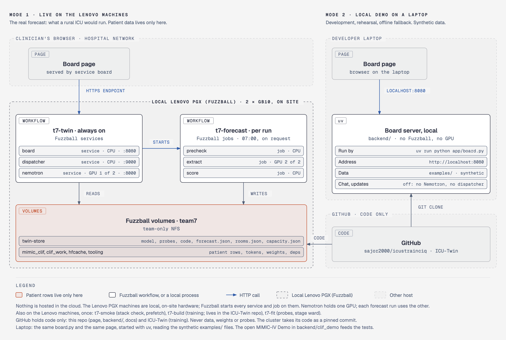

# Architecture and hosting

How the board fits ICU-Twin, how the team runs it on Fuzzball, and where it is hosted for the demo. Backend code: [vaishvikc/ICU-Twin](https://github.com/vaishvikc/ICU-Twin). Screens and rules: [`FRONTEND_SPEC.md`](FRONTEND_SPEC.md); the five calls between board and cluster: [`INTEGRATION.md`](INTEGRATION.md).

Editable source: [`diagrams/hosting.html`](diagrams/hosting.html).

## Components

| Part | What it is | Runs on | Reads | Writes |
|---|---|---|---|---|
| Team7 storage | `mimic_clif` (CLIF rows), `clif_work` (tokens, per-stay scores), `twin-store` (model, code, `forecast.json`) | Fuzzball NFS volumes, team-only | | |
| Build (`t7-build.fz`) | tokenize, drop the demo cohort, winnow (cut 24 h after ICU arrival), train `icutwin` on both GB10s | 2 GPUs, hours | `mimic_clif` | tokens to `clif_work`; model and code to `twin-store` |
| Forecast (`t7-forecast.fz`) | one forward pass per patient (`extract`), a logistic probe per task (13 heads + ward and step-down transfer), aggregate to unit counts with 80% ranges | 1 GPU for minutes, then CPU | `clif_work`, model | `twin-store/forecast.json` (counts only) |
| Twin (`t7-twin.fz`) | Nemotron 3 Nano (vLLM), the board server `app/board.py` (port 8080, team HTTPS endpoint), the dispatcher (06:30 daily and Rerun) | 1 GPU + CPU, always on | `forecast.json`, later `rooms.json` | run log: time, role, workflow id |
| Board (this repo) | static HTML, CSS and vanilla JS; no build step | inside the twin, on a laptop, or on Vercel | `/api/forecast`, `/api/runs`, `/api/rooms`; or `examples/forecast.json` | `/api/ask`, `/api/rerun` |

What the board shows: the six tasks in `forecast.json` `resources`. The other eight probe heads arrive in `other_tasks`: they appear only in the folded "All 14 forecasts" table at the foot of the board, labelled research only (D8).

## Data boundary

| Where | May hold | Never holds |
|---|---|---|
| `mimic_clif`, `clif_work` | patient rows, tokens, per-stay scores (credentialed MIMIC-IV) | |
| `twin-store`, board, Nemotron | counts with ranges; stage-ward rooms (open MIMIC-IV Demo, excluded from training) | real MIMIC-IV rows or per-patient scores |
| Laptop demo, Vercel preview, this repo | synthetic numbers (the mockup, `examples/forecast.json`) | anything from the cluster |

## Running it on Fuzzball (team)

Lane 2 owns starting and stopping the shared `t7-*` workflows; ask before starting anything. Details: the backend's `docs/TEAM_START.md` and the `fuzzball-ops` skill.

1. **Log in and check the context:** `fuzzball context list` (context `hack`, account team7).
2. **Volumes, once:** `mimic_clif` and `hfcache` exist. Create the rest after J.C.'s go-ahead:
   `fuzzball volume create team7 twin-store`, `... clif_work`, `... tooling`.
3. **Validate every file** before a start: `fuzzball workflow validate fuzzball/t7-<name>.fz` (all four validate once the volumes exist).
4. **Order:** `t7-smoke` (demo data, seeds the stack) → `t7-build` (both GPUs) → `t7-twin` (Nemotron + board + dispatcher, stays up) → `t7-forecast` (the dispatcher starts it at 06:30 and on Rerun; or start it by hand).
5. **Open the board:** `fuzzball workflow connect --name board --endpoint web <twin-workflow-id>` prints the team-scoped HTTPS address.
6. **Watch:** `fuzzball workflow describe <id>`, `fuzzball workflow log <id> <job> -n 200` (logs print counts only).

To ship a new board: copy `mockups/command-center.html` into the backend (served by `app/board.py`), push, and the next `t7-build` or `t7-smoke` publishes the code to `twin-store/code`; restart `t7-twin`.

## Hosting plan

| | Local demo (this laptop) | Fuzzball (live) | Vercel (public preview) |
|---|---|---|---|
| For | rehearsal, design review, offline fallback on stage | the real 07:00 board and the judged demo | sharing the design with judges and the team |
| Data | synthetic | real counts; open demo rooms | synthetic only |
| Chat and Rerun | mock replies | Nemotron and the dispatcher | mock replies |
| Address | `http://localhost:8000/mockups/command-center.html` | team-scoped HTTPS endpoint (step 5) | `https://<project>.vercel.app` |
| Who can open it | this laptop | team7 group only | anyone with the link |

**Local demo.** From this repo: `python3 -m http.server 8000`, then open the address above. Deep links: `#night`, `#room=20`, `#role=pharmacy`. To try the real server against the example file, from the backend repo: `uv run python app/board.py --forecast ../icustrainciq/examples/forecast.json --port 8080` (no Nemotron: the chat says it is not answering yet).

**Vercel.** Import this repo as a project (framework: Other, no build command, output directory: the repo root). `vercel.json` sends `/` to the mockup. It is a static page with synthetic numbers: never point it at the cluster's API, and never put cluster output in this repo. Deploying is a team decision (it publishes a public link).

**Stage fallback.** If the cluster is down during the demo, present the local demo and say it is the same page on synthetic data.

## User journey

Editable source: [`diagrams/journey.html`](diagrams/journey.html). The full journeys for every role are in [`USER_JOURNEY.md`](USER_JOURNEY.md).
