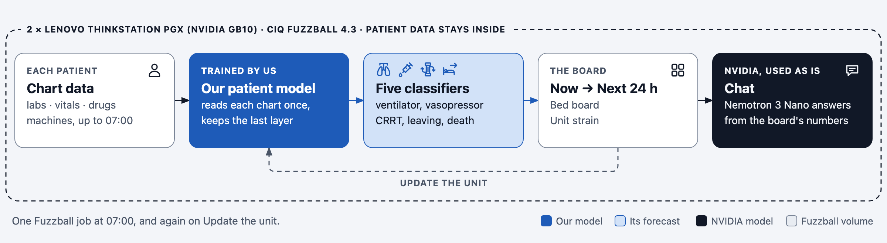
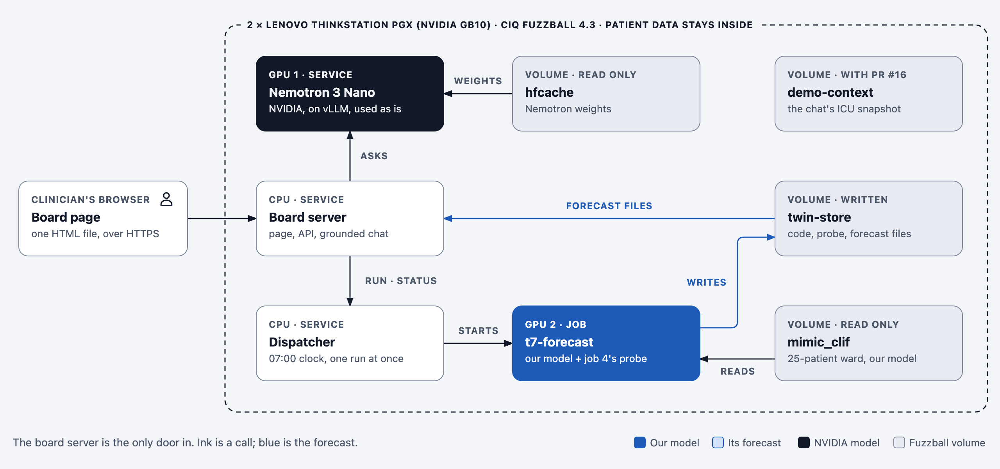
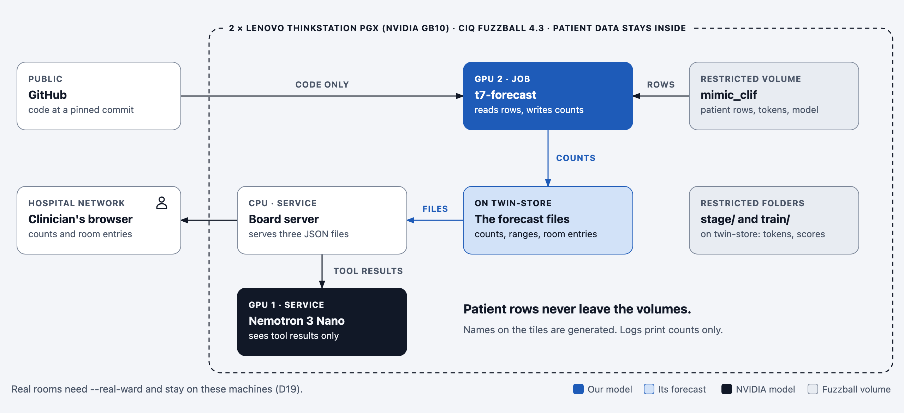
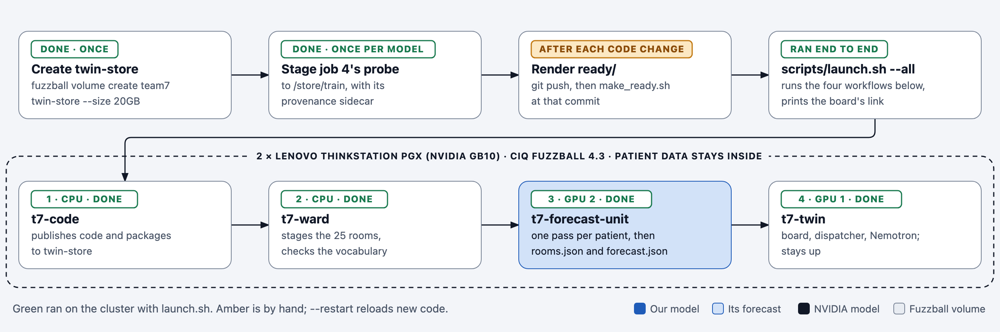

# Architecture

Read this if you want to know what ICU Lookahead runs, where it runs, and how to start it.

ICU Lookahead is a bed board for one ICU. It shows the life support each patient is on now and forecasts the next 24 hours. Everything runs on two Lenovo ThinkStation PGX machines under CIQ Fuzzball 4.3, and it has run there end to end. Nothing is hosted in the cloud, and GitHub holds code only.

| Section | Answers |
|---|---|
| [What runs where](#what-runs-where) | Which machine, service, job and volume holds each part |
| [Tech stack](#tech-stack) | Versions and image pins |
| [Two models, two jobs](#two-models-two-jobs) | What we trained and what we used as released |
| [How the model predicts](#how-the-model-predicts) | Last layer, five classifiers, held-out results |
| [Architecture](#architecture-1) | Services, the forecast job, the volumes |
| [Endpoints](#endpoints) | The board's API |
| [How the board starts a Fuzzball job](#how-the-board-starts-a-fuzzball-job) | From a click to a refreshed board |
| [Data boundary](#data-boundary) | Where patient data lives and what leaves the volumes |
| [How to run it](#how-to-run-it) | One command on the cluster, or a laptop demo |
| [What was validated](#what-was-validated) | What ran on the cluster, what was only checked, what is open |

Two pull requests are open. Rows marked **PR #16** (chat grounded in a shared ICU snapshot, draft) or **PR #20** (staffing and capacity in the backend, final board page) describe code that is not on `main` yet.

## What runs where


Each machine has one NVIDIA GB10 GPU. Fuzzball places CPU work on either machine.

| Part | Runs as | GPU | Port | Sees |
|---|---|---|---|---|
| Board page | one HTML file in the clinician's browser | none | the board's HTTPS endpoint | unit counts, room entries |
| Board server with the chat agent (`app/board.py`, `app/chat_agent.py`) | service `board` in workflow `t7-twin` | none | 8080, HTTPS endpoint `web` (group scope) | `forecast.json`, `rooms.json`, `capacity.json` |
| Dispatcher (`app/dispatcher.py`) | service `dispatcher` in `t7-twin` | none | 9000, inside the workflow | the run log and workflow list |
| Nemotron 3 Nano on vLLM | service `nemotron` in `t7-twin` | GPU 1, held | 8000, inside the workflow | chat tool results |
| Forecast with our patient model | workflow `t7-forecast`: jobs `precheck`, `extract`, `score` | GPU 2 for `extract`, minutes | none | the ward's tokens, the model, the probe |
| Code publish, ward staging | workflows `t7-code`, `t7-ward` | none | none | code; the ward's CLIF tables |
| Volume `mimic_clif` | mounted at `/data`, only read | | | the 25-patient ward, training tokens, the trained model |
| Volume `twin-store` | mounted at `/store`, the one volume we write | | | code, packages, the staged probe, staged tokens, the JSON files, `runs.jsonl` |
| Volume `hfcache` | mounted at `/cache` | | | Nemotron weights |
| Volume `demo-context` (**PR #16**) | mounted at `/context` by `t7-lookahead-*` | | | the selected 25-patient snapshot the chat is grounded in |
| Training | workflows `job_2_tokenize` to `job_4_probe` in [vaishvikc/ICU-Twin](https://github.com/vaishvikc/ICU-Twin) | both GPUs | none | MIMIC-IV in CLIF format |

The demo has one user at a time. There is no login; `role` is a label on the log and the answer.

## Tech stack

| Layer | Technology | Pin |
|---|---|---|
| Hardware | 2 × Lenovo ThinkStation PGX, NVIDIA GB10: 1 GPU, 20 cores, 128 GB unified memory each | driver 580, CUDA 13.0 |
| Orchestration | CIQ Fuzzball: services, jobs, volumes, HTTPS endpoints | 4.3.1 |
| Chat model | NVIDIA Nemotron 3 Nano 30B-A3B FP8 on vLLM, tool calling | `nvcr.io/nvidia/vllm:25.12.post1-py3`; model revision `9bee19446c0dfd01f356e10979d225b2a6621944` |
| Patient model | `icutwin` decoder (Gemma 4 E4B layer design, trained from scratch), then logistic probes | `nvcr.io/nvidia/pytorch:25.11-py3`; `transformers` 5.23.0, `scikit-learn` 1.9.1, `accelerate` 1.15.0, `safetensors` 0.8.0 |
| Data | CLIF 2.1 tables (MIMIC-IV in CLIF format), parquet | `clifpy` 2.1.0, `polars` 2.1.0, `pyarrow` 26.0.1, `numpy` 2.5.4 |
| Board server, dispatcher | Python standard library `http.server` | `python:3.12-slim` |
| Page | one HTML file, plain JavaScript and CSS, inline SVG icons | no build step, no third-party scripts |
| Packaging | `uv`; hash-locked requirements for the cluster | `backend/uv.lock`, `backend/requirements/t7-*.txt`, Python `>=3.12,<3.13` |
| Tests | `pytest`, `ruff` | `dev` extra in `backend/pyproject.toml` |

## Two models, two jobs

| | Patient model | Chat model |
|---|---|---|
| What | `icutwin`, a small decoder | NVIDIA Nemotron 3 Nano |
| Trained by | Us, on the two Lenovo machines, across both GPUs under Fuzzball | NVIDIA. We use it as released: no training, no fine-tuning |
| Reads | each patient's chart as a sequence of events | the forecast files, through tools |
| Does | one pass per patient; a classifier per question gives the five predictions | answers questions in plain words; can ask the dispatcher for a new run |
| Never | talks to users | predicts anything about a patient |
| Runs as | Fuzzball job on GPU 2 | Fuzzball service on GPU 1 |

## How the model predicts



1. **Training.** The model learned to read a chart as a sequence of events (labs, vital signs, drugs, machines) and predict the next event.
2. **Last layer.** At the cut, the model runs once over each patient's chart so far. We keep the output of its last layer: one vector per patient.
3. **Five classifiers.** A logistic classifier per event reads that vector: starting a ventilator, starting a vasopressor, starting CRRT, leaving the ICU, and death, each in the next 24 hours. The code calls a classifier a probe. Job 4 fits the probes on training patients beside the model they belong to; the forecast applies the saved probe and never refits.
4. **Unit counts.** Patient chances are added up into counts for the unit with an 80% range.

The cut is 24 hours after ICU arrival. One pass per patient takes minutes on one GPU.

Held-out AUROC runs from 0.771 (vasopressor start) to 0.930 (death) across the six fitted tasks. The two departure tasks combine into the board's "Leaving the ICU". Full table, ranges and a chart: [`RESULTS.md`](RESULTS.md).

## Architecture



| Part | Role |
|---|---|
| Board server | The only door in. Serves the page and the API, and holds the chat agent |
| Chat agent | A bounded tool-calling loop. Nemotron picks tools; answers come from tool results. **PR #16:** clinical answers are rendered from retrieved evidence (`app/evidence.py`) over one shared snapshot (`app/demo_context.py`) |
| Dispatcher | The 07:00 clock and the update button. Starts one forecast at a time through the Fuzzball CLI |
| `t7-forecast` | `precheck` (CPU) checks the probe, the model and the staged ward. `extract` (GPU 2) runs one pass per patient. `score` (CPU) applies job 4's probe and writes `rooms.json`, then `forecast.json` |
| `twin-store` | Everything we write. Files a reader may see mid-write are written to a temporary name and renamed |
| `mimic_clif`, `hfcache` | Only read: the ward and the model; the Nemotron weights |
| `demo-context` | **PR #16:** a restricted volume for the `t7-lookahead-prepare`, `-forecast` and `-chat` workflows; holds the roster, the token cache and `context.json` |

The page has two tabs, **Bed board** and **Unit strain**, and a **Now | Next 24 h** switch. Screens and states: [`FRONTEND_SPEC.md`](FRONTEND_SPEC.md).

## Endpoints


| Call | Body | Returns or starts |
|---|---|---|
| `GET /` | | the page (`app/static/index.html`) |
| `GET /api/forecast` | | `forecast.json`: five predictions as unit counts with 80% ranges |
| `GET /api/rooms` | | `rooms.json`: one entry per room |
| `GET /api/runs` | | dispatcher status: next 07:00, `scheduled.state`, running update, last runs |
| `GET /api/capacity` | | `life_support_patients`, `vents_free`, `updated_at`. **PR #20** adds `vents_total`, `crrt_total`, `crrt_free`, `set_by_role` |
| `POST /api/rerun` | `{role, scope: "unit" or "room", room?}` | starts one forecast: `{started, name}` or `{started: false, reason}` |
| `POST /api/capacity` | `{life_support_patients, vents_free?, role}`. **PR #20** adds `vents_total`, `crrt_total`, `nurses_on_shift`, `rt_on_shift` | saves `capacity.json`; whole numbers 0 to 50 |
| `POST /api/ask` | `{question, role, room?, seen_made_at?}` | `{answer, made_at, trace?}` |

Every POST needs `Content-Type: application/json` and `X-Lookahead: 1`. If the browser sends an `Origin` header, it must match `Host`. Anything else gets 403. The dispatcher's two endpoints, `GET /status` and `POST /run`, answer only the board server. JSON shapes: [`../backend/docs/CONTRACT.md`](../backend/docs/CONTRACT.md).

## How the board starts a Fuzzball job


1. The user presses **Update the unit**. The page sends `POST /api/rerun`; the board server passes it to the dispatcher (`POST /run`).
2. The dispatcher checks its guards: one forecast at a time, 20 minutes between updates of the same scope.
3. Fuzzball 4.3 workflows take no parameters. The dispatcher fills six tokens (`@SCOPE@`, `@ROOM@`, `@HOURS@`, `@WARD_FLAG@`, `@CLIF_DIR@`, `@NAMES@`) in a copy of `t7-forecast.fz` and starts it with `fuzzball workflow start`.
4. `precheck`, `extract` and `score` run. `forecast.json` is written last; the page watches its `made_at`.
5. The page polls `/api/runs` every 30 seconds during a run and every 5 minutes otherwise. When `made_at` changes it reloads.

A room update (`{scope: "room", room: 12}`) rewrites that one room. It is refused until a whole-unit run exists.

**The 07:00 run.** Fuzzball 4.3 has no cron, so the dispatcher is the clock. At 07:00 America/Chicago it starts a unit run. If a GPU workflow is running or the start fails, it retries each minute for 10 minutes. A dispatcher that starts after 07:00 with no run since the cut runs it once. `GET /api/runs` reports `scheduled.state`: `pending`, `ok`, `failed` or `missed`.

## Data boundary



The demo ward is a CLIF-format extract of 25 MIMIC-IV hospitalizations on `mimic_clif:/dashboard_data/`. This is credentialed patient data. The repo is public.

| Where | Holds | Never holds |
|---|---|---|
| `mimic_clif` (only read) | the ward's CLIF tables, training tokens, the trained model | anything ICU Lookahead writes |
| `twin-store`, folders `stage/` and `train/` | tokens, features, per-stay scores, the staged probe; restricted | |
| `rooms.json`, `forecast.json`, board server, Nemotron, browser | unit counts with ranges; room entries by room number with generated names | patient rows, stay ids, real names |
| Laptop, GitHub | code, synthetic `examples/`, the open MIMIC-IV Demo in `backend/clif_demo/` | anything from the cluster volumes |

| Rule | Source |
|---|---|
| The open MIMIC-IV Demo ward is the default. Room views and room chat on real MIMIC-IV need `--real-ward` and stay on the local machines | [`DECISIONS.md`](DECISIONS.md) D6, D19 |
| Names on the tiles are generated per room by `app/fake_names.py` (`--names fake`). No name file is read | `backend/app/fake_names.py` |
| Jobs and scripts print counts only: never a row, an id, a date or a name | `backend/README.md` |
| The chat refuses a question that names a patient identifier before any model call | `backend/docs/CHAT_AGENT.md` |
| Patient data, model weights and probes are never committed | `AGENTS.md` |
| **PR #16:** without `--real-ward` the board serves a real ward as counts only: no rooms, no room chat | `backend/fuzzball/t7-twin.fz` on the PR branch |

## How to run it

### On the cluster



From `backend/`, on a laptop with the `fuzzball` CLI logged in:

```bash
bash scripts/launch.sh          # start t7-twin if it is not running, wait for the board, print and open its link
bash scripts/launch.sh --all    # publish code, stage the ward, forecast, then open the board
bash scripts/launch.sh --restart   # after new code: stop t7-twin and start it again
bash scripts/launch.sh --link   # print the link of the running board
```

| Step | When | How |
|---|---|---|
| Create `twin-store` | once per cluster | `fuzzball volume create team7 twin-store --size 20GB` |
| Stage job 4's probe | once per model | copy `probe.joblib` to `/store/train/probe-final.joblib` and write its provenance sidecar ([`RUNBOOK.md`](../backend/docs/RUNBOOK.md) section 4). `t7-fit` is the fallback when job 4 has not run |
| Render `fuzzball/ready/` | after every code change | `git push`, then `scripts/make_ready.sh <commit>`; check the ingress line names this repo |
| `t7-code` | `launch.sh --all` or `--code` | publishes `backend/` at the pinned commit to `/store/code` and the packages to `/store/py` |
| `t7-ward` | `launch.sh --all` or `--ward` | stages the 25 rooms to `/store/stage`; checks the vocabulary against the model |
| `t7-forecast-unit` | `launch.sh --all` or `--forecast`; afterwards the dispatcher | GPU 2: writes `rooms.json` and `forecast.json` |
| `t7-twin` | every launch | GPU 1: board, dispatcher, Nemotron. Stays up |

The cluster runs the commit pinned in `fuzzball/ready/`, not the working tree. Only one GPU job runs beside Nemotron. Setup, checks, stopping and known failures: [`../backend/docs/RUNBOOK.md`](../backend/docs/RUNBOOK.md).

### On a laptop

From `backend/`:

```bash
uv run --extra dev --extra model pytest -q
uv run python app/board.py --forecast ../examples/forecast.json --static ../mockups/command-center.html --port 8080
```

Open http://localhost:8080. This serves synthetic data. Without Nemotron and the dispatcher, the chat and the update buttons say they are not available.

## What was validated

| Claim | State | Evidence |
|---|---|---|
| The patient model trained on both GPUs under Fuzzball | Ran | Job 3 in vaishvikc/ICU-Twin; checkpoint 2616 of 4351 was packaged as `model_output/final/` and its load test printed `LOADTEST OK` ([`FUZZBALL_VALIDATION.md`](../backend/docs/FUZZBALL_VALIDATION.md)) |
| The classifiers hold up on patients they never saw | Ran | Job 4: held-out AUROC 0.771 to 0.930 ([`RESULTS.md`](RESULTS.md)) |
| Workflow files are valid Fuzzball 4.3 | Checked | `fuzzball workflow validate` on the rendered files ([`FUZZBALL_VALIDATION.md`](../backend/docs/FUZZBALL_VALIDATION.md)) |
| Guards, JSON shapes and the API | Tested off the cluster | `backend/tests/` |
| The whole app, end to end | Ran | The team ran it on the two Lenovo machines under Fuzzball with `scripts/launch.sh` on 2026-11-14: code publish, ward staging, forecast, then the board with Nemotron. Failures met on the way and their fixes: [`RUNBOOK.md`](../backend/docs/RUNBOOK.md) section 7 |
| This repo's rendered files | Open | `fuzzball/ready/` pins a commit older than the templates. Render again before publishing from this repo (`backend/fuzzball/ready/README.md`) |
| Chat grounding in **PR #16** (`t7-lookahead-prepare`, `-forecast`, `-chat`) | Not run | Synthetic tests only; no model inference or real-data acceptance is claimed |
| `t7-twin` without Nemotron (the no-chat fallback) | Not run | |
| Time and memory of `extract` | Open | The values in `t7-forecast.fz` are starting values |
| Clinical use | Not done | Retrospective check on one public dataset. Not a prospective test, not another hospital, not a medical device |

## More

| Read | For |
|---|---|
| [`RESULTS.md`](RESULTS.md) | held-out results per task |
| [`DECISIONS.md`](DECISIONS.md) | why it is built this way |
| [`USER_JOURNEY.md`](USER_JOURNEY.md) | each role's morning |
| [`../backend/README.md`](../backend/README.md) | the backend, module by module |
| [`diagrams/make_figures.py`](diagrams/make_figures.py) | the source of every figure; design rules in [`../DESIGN.md`](../DESIGN.md), section "Diagrams" |
