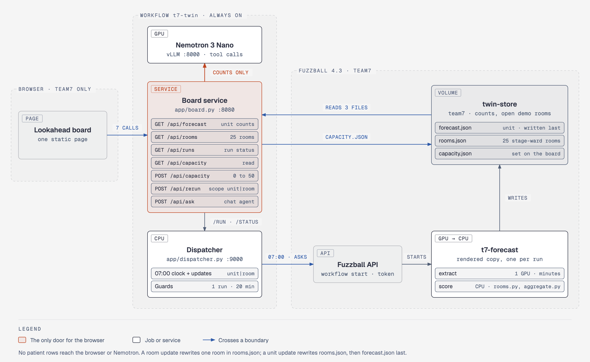
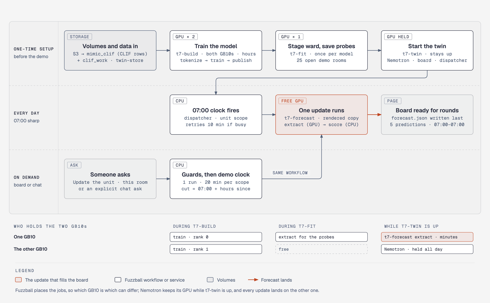

# Architecture and hosting

How the board fits ICU-Twin, how the team runs it on Fuzzball, and where it is hosted for the demo. Backend code: [vaishvikc/ICU-Twin](https://github.com/vaishvikc/ICU-Twin). Screens and rules: [`FRONTEND_SPEC.md`](FRONTEND_SPEC.md); the five calls between board and cluster: [`INTEGRATION.md`](INTEGRATION.md).

Editable source: [`diagrams/hosting.html`](diagrams/hosting.html).

## How the pieces connect

The page talks to one service, `app/board.py` on port 8080, through seven operations: `GET /api/forecast`, `/api/rooms`, `/api/runs`, `/api/capacity`, and `POST /api/rerun` (scope `unit` or `room`), `/api/capacity`, `/api/ask`. The service sends counts only to Nemotron (a tool-calling chat agent) and asks the dispatcher on port 9000, which renders a copy of `t7-forecast.fz` for each run and starts it through the Fuzzball API at 07:00 and on request. The workflow extracts on one GPU, scores on CPU (`rooms.py`, then `aggregate.py`) and writes `rooms.json` and `forecast.json` to `twin-store`, where the service reads them and keeps `capacity.json`. Editable source: [`diagrams/connection.html`](diagrams/connection.html).

## From data to the 07:00 board

Setup happens once: volumes and data, `t7-build` on both GB10s, `t7-fit` (stages the 25-room ward and saves the probes), then `t7-twin`, where Nemotron takes one GPU and keeps it. After that the same workflow, `t7-forecast`, fills the board every time: at 07:00 from the dispatcher's clock, and on request after the guards and the demo clock. The strip under the lanes shows which GB10 holds what in each phase. Editable source: [`diagrams/lifecycle.html`](diagrams/lifecycle.html).

## An update request, end to end

A nurse taps "Update this room". The dispatcher either refuses in plain words (shown word for word) or starts a room-scope copy of `t7-forecast`; the page polls `/api/runs` every 30 s, reloads `/api/rooms` and refreshes the room in place. A room update leaves `forecast.json` and its `made_at` untouched, so the chat's "Forecast updated at HH:MM" line appears only after a unit update; after a room update the chat's `get_room` returns the room's new `updated_at`. Editable source: [`diagrams/sequence.html`](diagrams/sequence.html).

## In real life, step by step

1. **Once: storage.** Create `twin-store`, `clif_work` and `tooling`; load the CLIF rows into `mimic_clif`.
2. **Once: train.** `t7-build` tokenizes, drops the demo cohort, trains `icutwin` on both GB10s and publishes model and code to `twin-store`.
3. **Once per model: fit.** `t7-fit` picks the 25 stage-ward stays (open MIMIC-IV Demo), extracts features on one GPU and saves one probe per task. An update never refits.
4. **Start the twin.** `t7-twin` brings up Nemotron (holds one GPU), the board service and the dispatcher, and stays up.
5. **Every day at 07:00.** The dispatcher starts a unit-scope `t7-forecast` (it retries each minute for 10 minutes if another run is active). Until it lands, the board keeps the last forecast, marked "updating".
6. **The run.** `extract` takes the free GPU for minutes; `score` runs on CPU, writes `rooms.json`, then `forecast.json` last. The page sees the new `made_at` and refreshes in place: five predictions for 07:00 to 07:00.
7. **On request.** "Update the unit", "Update this room", or an explicit ask in the chat ("update room 12") goes through `POST /api/rerun` to the dispatcher. Guards: one run at a time, 20 minutes between updates of the same scope (per room for rooms; a unit update counts for every room). A refusal says why, for example "Updated 12 minutes ago. You can update again at 13:17."
8. **Demo clock.** The stage ward is a replay, so an update moves every room's cut forward by the hours since 07:00 (an update at 11:30 is 07:00 + 4.5 h). Numbers change because the cut moves, not because new patients arrive.
9. **Capacity.** The charge nurse enters life-support patients the unit can carry and ventilators free; the board service writes `capacity.json`, and the next unit update uses it.

## Components

| Part | What it is | Runs on | Reads | Writes |
|---|---|---|---|---|
| Team7 storage | `mimic_clif` (CLIF rows), `clif_work` (tokens, per-stay scores), `twin-store` (model, code, `forecast.json`) | Fuzzball NFS volumes, team-only | | |
| Build (`t7-build.fz`) | tokenize, drop the demo cohort, winnow (cut 24 h after ICU arrival), train `icutwin` on both GB10s | 2 GPUs, hours | `mimic_clif` | tokens to `clif_work`; model and code to `twin-store` |
| Fit (`t7-fit.fz`) | once per model: pick the 25 stage-ward stays, tokenize them, extract features, fit and save one logistic probe per task | 1 GPU, then CPU | `clif_work`, model | probes to `twin-store/probes`; stage ward to `clif_work/stage` |
| Forecast (`t7-forecast.fz`) | one forward pass per patient (`extract`), apply the probes saved by `t7-fit` (never refit), write the rooms, aggregate to unit counts with 80% ranges; scope `unit` or `room` | 1 GPU for minutes, then CPU | `clif_work`, model, probes | `twin-store/rooms.json`, then `forecast.json` (unit scope) |
| Twin (`t7-twin.fz`) | Nemotron 3 Nano (vLLM), the board server `app/board.py` (port 8080, team HTTPS endpoint), the dispatcher (07:00 daily and updates on request) | 1 GPU + CPU, always on | `forecast.json`, later `rooms.json` | run log: time, role, workflow id |
| Board (this repo) | static HTML, CSS and vanilla JS; no build step | inside the twin, on a laptop, or on Vercel | `/api/forecast`, `/api/runs`, `/api/rooms`, `/api/capacity`; or `examples/forecast.json` | `/api/ask`, `/api/rerun`, `/api/capacity` |

What the board shows: the five predictions in `forecast.json` `resources` (D8: ICU discharge, IMV, vasopressor, CRRT, death; next 24 h, 07:00 to 07:00).

## Data boundary

| Where | May hold | Never holds |
|---|---|---|
| `mimic_clif`, `clif_work` | patient rows, tokens, per-stay scores (credentialed MIMIC-IV) | |
| `twin-store`, board, Nemotron | counts with ranges; stage-ward rooms (open MIMIC-IV Demo, excluded from training) | real MIMIC-IV rows or per-patient scores |
| Laptop demo, Vercel preview, this repo | synthetic numbers (the mockup, `examples/forecast.json`) | anything from the cluster |

## Running it on Fuzzball (team)

Lane 2 owns starting and stopping the shared `t7-*` workflows; ask before starting anything. Details: the backend's `docs/TEAM_START.md` and the `fuzzball-ops` skill.

1. **Log in and check the context:** `fuzzball context list` (context `hack`, account team7).
2. **Volumes, once:** `mimic_clif` and `hfcache` exist. Create the rest after J.C.'s go-ahead:
   `fuzzball volume create team7 twin-store`, `... clif_work`, `... tooling`.
3. **Validate every file** before a start: `fuzzball workflow validate fuzzball/t7-<name>.fz` (all four validate once the volumes exist).
4. **Order:** `t7-smoke` (demo data, seeds the stack) → `t7-build` (both GPUs) → `t7-fit` (once per model: stage ward, probes) → `t7-twin` (Nemotron + board + dispatcher, stays up) → `t7-forecast` (the dispatcher starts it at 07:00 and on request; by hand, render the template first).
5. **Open the board:** `fuzzball workflow connect --name board --endpoint web <twin-workflow-id>` prints the team-scoped HTTPS address.
6. **Watch:** `fuzzball workflow describe <id>`, `fuzzball workflow log <id> <job> -n 200` (logs print counts only).

To ship a new board: copy `mockups/command-center.html` into the backend (served by `app/board.py`), push, and the next `t7-build` or `t7-smoke` publishes the code to `twin-store/code`; restart `t7-twin`.

## Hosting plan

| | Local demo (this laptop) | Fuzzball (live) | Vercel (public preview) |
|---|---|---|---|
| For | rehearsal, design review, offline fallback on stage | the real 07:00 board and the judged demo | sharing the design with judges and the team |
| Data | synthetic | real counts; open demo rooms | synthetic only |
| Chat and Rerun | mock replies | Nemotron and the dispatcher | mock replies |
| Address | `http://localhost:8000/mockups/command-center.html` | team-scoped HTTPS endpoint (step 5) | `https://<project>.vercel.app` |
| Who can open it | this laptop | team7 group only | anyone with the link |

**Local demo.** From this repo: `python3 -m http.server 8000`, then open the address above. Deep links: `#night`, `#room=20`, `#role=pharmacy`. To try the real server against the example file, from the backend repo: `uv run python app/board.py --forecast ../icustrainciq/examples/forecast.json --port 8080` (no Nemotron: the chat says it is not answering yet).

**Vercel.** Import this repo as a project (framework: Other, no build command, output directory: the repo root). `vercel.json` sends `/` to the mockup. It is a static page with synthetic numbers: never point it at the cluster's API, and never put cluster output in this repo. Deploying is a team decision (it publishes a public link).

**Stage fallback.** If the cluster is down during the demo, present the local demo and say it is the same page on synthetic data.

## User journey

Editable source: [`diagrams/journey.html`](diagrams/journey.html). The full journeys for every role are in [`USER_JOURNEY.md`](USER_JOURNEY.md).
