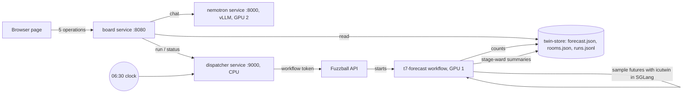

# Integration: how the board talks to the cluster

How model output (the `icutwin` futures sampled on the GPUs, the unit counts, the stage-ward rooms) and the Nemotron chat reach the browser; how the browser sends requests; and what the Fuzzball team (lane 2, with lane 3) must provide. Spec: [`FRONTEND_SPEC.md`](FRONTEND_SPEC.md). Build plan: [`FRONTEND_PLAN.md`](FRONTEND_PLAN.md). Backend: [vaishvikc/ICU-Twin](https://github.com/vaishvikc/ICU-Twin).

Terms follow the codebase-design vocabulary: a **module** has an **interface** at a **seam**; an **adapter** fills a seam; a module is **deep** when a small interface hides a lot of behaviour.

## The one seam the frontend sees

The browser talks to exactly one module: the **board** service (`app/board.py`, service `board` in `fuzzball/t7-twin.fz`, port 8080, team-scoped HTTPS endpoint). Its interface is five operations:

| Operation | Request | Response | Hides |
|---|---|---|---|
| Read the unit | `GET /api/forecast` | `forecast.json`: counts per team, horizons, per day, already started | the forecast files on `twin-store`, staleness |
| Read the runs | `GET /api/runs` | `{next_scheduled, recent: [{at, trigger, workflow, name, started}]}` | the dispatcher service and Fuzzball |
| Read the rooms | `GET /api/rooms` | `rooms.json` (stage ward only; contract in the plan) | trajectory summaries, the open-data rule |
| Ask | `POST /api/ask {question, role, room?}` | `{answer}` | prompt assembly, Nemotron, the rerun intent, privacy rules |
| Rerun | `POST /api/rerun {role}` | `{started, name, workflow}` or `{started: false, reason}` | the dispatcher's guards, the workflow token, the two-GPU rule |

That is the whole contract. The page never calls Nemotron, the dispatcher or Fuzzball directly, never holds a token, and never sees a file path. **Two adapters fill this seam**: the live board on the cluster, and the page's own mock mode (`?mock=1` reads `examples/forecast.json`, `examples/rooms.json`, and answers ask/rerun locally). Two adapters make the seam real: lane 4 builds and tests against mock mode while the cluster is busy, and switches by URL.

New over today's backend: `GET /api/rooms` and the optional `room` field on `/api/ask` (the board assembles that room's futures into Nemotron's context, stage ward only). Everything else already exists in `app/board.py`.

## Behind the seam (the board's internal seams)

| Internal seam | Adapter today | Why it is a seam |
|---|---|---|
| Board to forecast store | files on `twin-store` (`/store/forecast.json`, `/store/rooms.json`) | tests use a temp directory; the store could become VAST DataBase later (QUESTIONS V7) without the page noticing |
| Board to Nemotron | OpenAI-compatible HTTP to `http://nemotron:8000` | tests use an unreachable URL (degrades to "not answering yet") |
| Board to dispatcher | HTTP to `http://dispatcher:9000` | tests run a fake dispatcher; deletion test: without it, schedule, guards and token refresh would spread into the board |
| Dispatcher to Fuzzball | Fuzzball CLI with the injected workflow token | tests fake the CLI; the guards are tested without a cluster |

## The model output, end to end

1. **06:30** the dispatcher starts `t7-forecast.fz` (or a nurse or physician presses Rerun, or asks the chat). The job runs on one GPU while Nemotron holds the other.
2. **Sample.** `icutwin-gen-score` samples 100 futures per patient with SGLang in-process and counts each event within 24, 48 and 72 h (clock tokens) and over the rest of the stay.
3. **Unit counts.** `app/aggregate.py` sums per-patient risks into `forecast.json` (counts only) on `twin-store`.
4. **Stage-ward rooms (to build).** Today nothing scores the stage ward: the build removes the open MIMIC-IV Demo patients from every split, and the scorer keeps only per-patient means, not the futures. So `t7-forecast.fz` needs a second, small pass:
   - tokenize `clif_demo` (as `t7-smoke.fz` already does) and cut at 24 h after ICU arrival;
   - sample with the same model and **keep the futures** for these rooms only (event names, hit hours from clock tokens, ending hour);
   - summarize per room: risk per horizon, `hit_hours`, `ends_hours`, the events that most often came before each outcome, and the last 12 h of events read;
   - write `rooms.json` to `twin-store` (open data, no identifiers).
5. **The page** polls `GET /api/runs` every 30 s while a run is active and every 5 min otherwise; when `made_at` changes it reloads `/api/forecast` and `/api/rooms`.

**Open decision for the team (raise at the next stand-up):** on stage, should the margin's unit strain come from the same 25 stage-ward rooms as the magnets (one coherent unit, all open data), with real MIMIC-IV used for training and the backtest numbers only? Mixing a real held-out unit in the margin with demo rooms on the board shows two different populations on one screen.

## The chat, end to end

1. The page posts `{question, role, room?}`. The page never builds prompts.
2. The board checks for the rerun intent first; if it matches, it calls the dispatcher and answers with the outcome.
3. Otherwise it builds Nemotron's context: the counts from `forecast.json`; if `room` is set and the room is in `rooms.json`, that room's summary (never real MIMIC-IV rows). System prompt: answer only from that context, name the horizon, quote the 80% range, evidence not cause, no treatment advice.
4. Nemotron answers; the board returns `{answer}`. Questions are never logged.

## Requests from the page: rules

- Same-origin only (the page is served by the board); no CORS, no tokens in the page.
- Timeouts: 10 s for reads, 150 s for ask, 150 s for rerun; show "still working" after 3 s.
- Retries: reads retry twice with backoff; ask and rerun never auto-retry (a rerun could double-start; the dispatcher's guard would refuse, but say it plainly).
- Every failure shows the reason the server gave, verbatim, and leaves the last good forecast on screen.

## What the Fuzzball team must provide

| # | Item | Owner | Why the frontend needs it |
|---|---|---|---|
| 1 | Create volumes `twin-store`, `tooling`, `hfcache`, `clif_work` on provisioner `team7` (all five workflows stop at a missing volume today) | lane 2 | nothing runs without them |
| 2 | Bring up `t7-twin.fz`; send lane 4 the board URL (`fuzzball workflow endpoints list`) and how teammates and judges open it (`fuzzball workflow connect --name board --endpoint web <id>`, or an endpoint token) | lane 2 | the page has a home |
| 3 | Confirm the cluster web UI address and set `FB_UI_URL` in `t7-twin.fz` | lane 2 | the dispatcher downloads the CLI from it; without it Rerun and the 06:30 run fail |
| 4 | Add the stage-ward pass to `t7-forecast.fz` and a trajectory summary (step 4 above), writing `/store/rooms.json` | lane 3 with Vaishvik | room drawer and room chat |
| 5 | `app/board.py`: serve `app/static/index.html` at `/`, add `GET /api/rooms`, accept `room` on `/api/ask` | lane 4 (backend PR) | the five-operation interface |
| 6 | Tell lane 4 how long one `t7-forecast` takes on one GPU | lane 3 | the page shows "running, about N min" |
| 7 | Keep the service names `board`, `nemotron`, `dispatcher` and ports 8080, 8000, 9000 | lane 2 | the board's adapters are wired by name |

How lane 4 helps the Fuzzball team back: mock mode means no one waits on the cluster to build the page; the page shows the dispatcher's reasons and run status, so a stuck workflow is visible on the board instead of only in `fuzzball workflow list`; and the rerun button gives lane 2 a one-click way to test the dispatcher once `t7-twin` is up.
