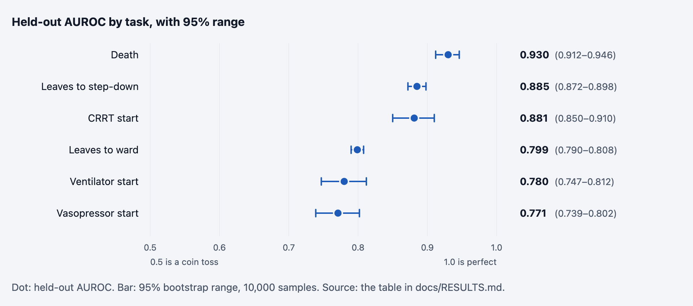

# Model results on held-out patients

Read this if you want the numbers behind the forecast: how the patient model's classifiers did on patients they never saw.

| Setup | |
|---|---|
| Data | MIMIC-IV in CLIF format |
| Hardware | trained and run on the two local Lenovo PGX machines |
| Cut | 24 hours after ICU arrival |
| Question per task | does the event happen in the next 24 hours? |
| Fitting | cross-validation on the training patients |
| Held-out patients | kept apart until the end |
| Ranges | 95% bootstrap intervals from 10,000 samples |

## Held-out results

| Task | Held-out patients | Events | Prevalence | AUROC (95% range) | AUPRC (95% range) | Brier |
|---|---:|---:|---:|---|---|---:|
| Death | 12,759 | 198 | 1.6% | **0.930** (0.912–0.946) | 0.399 (0.33–0.47) | 0.012 |
| Leaves to step-down | 12,052 | 508 | 4.2% | **0.885** (0.872–0.898) | 0.330 (0.29–0.37) | 0.033 |
| CRRT start | 12,562 | 123 | 1.0% | **0.881** (0.850–0.910) | 0.155 (0.10–0.22) | 0.009 |
| Leaves to ward | 9,077 | 2,723 | 30.0% | **0.799** (0.790–0.808) | 0.579 (0.56–0.60) | 0.162 |
| Ventilator start | 7,264 | 226 | 3.1% | **0.780** (0.747–0.812) | 0.235 (0.18–0.29) | 0.027 |
| Vasopressor start | 8,805 | 226 | 2.6% | **0.771** (0.739–0.802) | 0.152 (0.11–0.20) | 0.023 |

## Training patients

| Task | Train patients | Events | Cross-validated AUROC |
|---|---:|---:|---:|
| Death | 44,442 | 723 | 0.927 |
| Leaves to step-down | 42,053 | 1,538 | 0.875 |
| CRRT start | 43,773 | 372 | 0.876 |
| Leaves to ward | 31,324 | 9,545 | 0.808 |
| Ventilator start | 25,307 | 780 | 0.769 |
| Vasopressor start | 30,230 | 796 | 0.792 |

Held-out AUROC is close to the cross-validated AUROC for every task.

## How to read the metrics

- **AUROC:** the chance that the model ranks a random patient who had the event above one who did not. 0.5 is a coin toss; 1.0 is perfect.
- **AUPRC:** a summary of precision across all thresholds, read against the event's own rate (prevalence); a model that guesses scores about the prevalence. It is not the precision at the board's flag line; that would need precision measured at that threshold.
- **Brier:** the mean squared error of the predicted chance. Lower is better; compare it with the prevalence.
- **Patient counts differ by task** because a patient already on that support at the cut is not counted for its start (for example, a patient already on a ventilator cannot start one).

## How the board uses these tasks

- The board's **Leaving the ICU** combines the two departure tasks: leaves to a ward plus leaves to step-down.
- **Ventilator**, **vasopressor** and **CRRT** are the three life-support starts; **death** is shown as a plain row and a unit count, never as a bed colour.

## Limits

- A retrospective check on one public research dataset.
- Not a prospective test, and not a test at another hospital.
- Not clearance as a medical device.

The board is for unit planning. The care team makes clinical decisions.
