# Page changes for Dema and J.C. to review

Read this before the morning meeting on 2026-11-15. It lists every change this repo made to Dema's final board page (ICU-Twin `55df710`, decision D25), with a before and after picture, the reason, and how to undo it. Nothing here is in ICU-Twin yet. Section 4 says how to bring across what you approve.

The page is still Dema's design: the same layout, tiles, person figure, circle icons, event cards, settings panel, bed pop-up and colours. These are refinements on top (D27).

- Page file: [`mockups/command-center.html`](../mockups/command-center.html); the served copy `backend/app/static/index.html` is byte-identical.
- Open it without a server: `python3 -m http.server 8000`, then `http://localhost:8000/mockups/command-center.html#synthetic` (made-up patients).
- "Before" pictures are Dema's page as it was on `main` before PR 24 and this pull request (flag line 25%). All pictures use made-up patients. In the bed-board "before" pictures the death threshold is set to 5% so that the death marks show.

## 1. Decide these in the meeting

| # | Change | Decision it follows | Approve? |
|---|---|---|---|
| 1 | Death is hidden on bed tiles | J.C. Q4/Q9, D13 | |
| 2 | Deaths is one unit count in the alert line | J.C. Q4/Q9 | |
| 3 | Deaths card shows only the unit count and range | PR 24, D26 | |
| 4 | "See first" row above the bed grid | J.C. Q6a | |
| 5 | Quieter tiles | J.C. Q6a | |
| 6 | "Update the unit" shows its progress | J.C. Q6b | |
| 7 | Chat: clearer suggested questions | J.C. Q6c | |
| 8 | Chat opens above an open bed (bug fix) | J.C. Q6c | |
| 9 | Escape closes one panel at a time (bug fix) | PR 24 | |
| 10 | 44 px touch targets on bed chips and Change links | PR 24 | |
| 11 | Header reads "ICU Lookahead" | D24 | |
| 12 | Phone layout at 390 px | J.C. Q6d | |
| 13 | No console error when no context is published | bug fix | |
| 14 | Standard flag lines 20% / 40% / 60% and "Reset to standard" | D26; applied: J.C. merged PR 24 | |

Not applied, for you to decide: section 3.

## 2. Each change

"Undo" names the code to revert in `mockups/command-center.html`. After any undo, copy the file to `backend/app/static/index.html` and run the page tests (`cd backend && uv run --extra dev --extra model --with playwright python -m pytest -q tests/test_page_browser.py`).

### 1. Death is hidden on bed tiles

| Before | After |
|---|---|
| 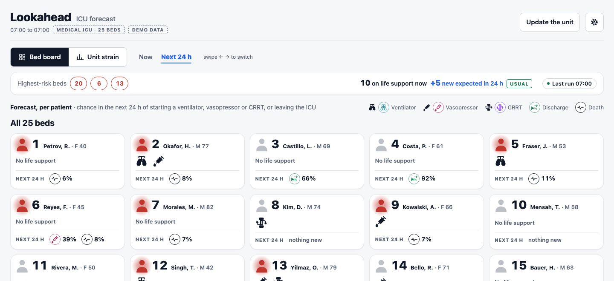 | 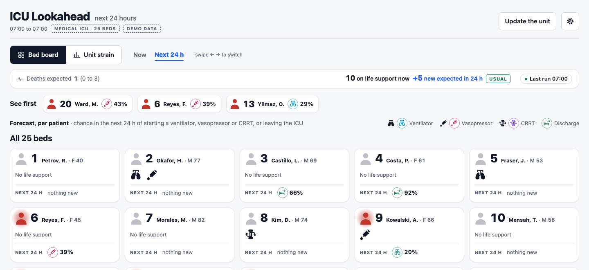 |

**What.** A tile no longer shows the death circle with its chance, and the person figure no longer turns red for death. Only a new life support turns the figure red. The Death row in the Settings thresholds is gone, because it now has nothing to switch. The key above the grid no longer lists Death. The tile's spoken label no longer mentions death.

**Why.** J.C.'s decision Q4/Q9 and D13: death never colours or marks a bed. In the "before" picture, with a low death threshold, most of the unit is red.

**Where death still is.** In the bed pop-up, as the fifth row, "Dies in hospital", always with its chance (unchanged). In the alert line (change 2). On the Deaths card (change 3).

**Undo.** Restore `showDeath` and its three uses (`flow`, `flowWords`, `bedTile`), `death` in `LINE_DEF`, the `row("death", …)` line in `paintFlag`, and the Death entry in `paintLegend`.

### 2. Deaths is one unit count in the alert line

| Before | After |
|---|---|
| 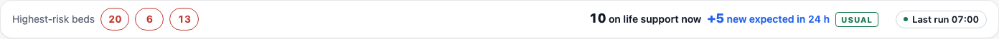 | 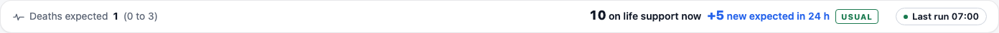 |

**What.** The line above the beds now carries "Deaths expected 1 (0 to 3)", on both tabs. When the forecast has no death estimate it reads "Deaths expected no data".

**Why.** Q4/Q9: death is shown as one unit count. Before, on the Bed board the count was not visible at all.

**Undo.** Remove the `dth` span in `renderStrain` and the `.dth` CSS rules.

### 3. Deaths card shows only the unit count and range

| Before | After |
|---|---|
| 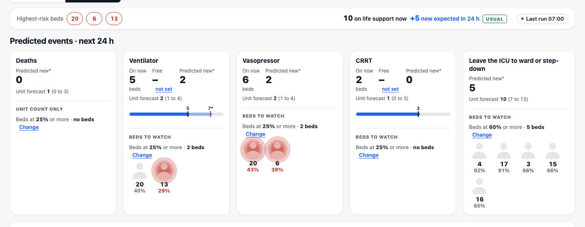 | 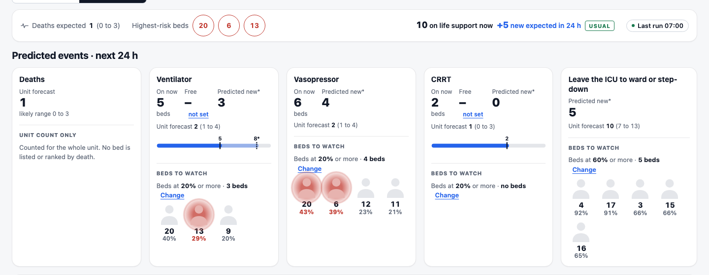 |

**What.** The Deaths card read "Predicted new* 0", "Beds at 25% or more · no beds" and a Change link, as if beds were counted by death. It now reads the unit forecast, its likely range, and "Counted for the whole unit. No bed is listed or ranked by death."

**Why.** D13 and D26; CodeRabbit on PR 19. From PR 24.

**Undo.** In `renderWatch`, remove the four `k==="death"` branches in `card`.

### 4. "See first" row

Pictures: change 1, above the grid.

**What.** One compact row at the top of the Bed board names the three beds with the highest chance of a new life support, using Dema's own top-beds rule (`topBeds`, the rule that already picked the three pulsing figures on Unit strain; a tie with the third is included). Each is a button: her red person figure, the bed number, the name, and the bed's top event as her circle icon with its chance. Pressing it opens the bed. The "Highest-risk beds 20 6 13" chips, which said the same thing without the reason, are hidden on the Bed board and stay on Unit strain. The row is not shown in Now.

**Why.** Q6a: a faster read at 07:00. The three beds and why are readable from across the room before any tile.

**Undo.** Remove `renderSeeFirst` and its call in `renderGrid`, the `#seefirst` section in the HTML, the `.seefirst` and `.sfb` CSS, and the rule `[data-view="beds"][data-mode="next"] .alerts .hi{display:none}`.

### 5. Quieter tiles

| Before | After |
|---|---|
| 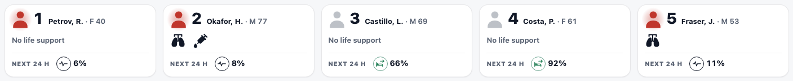 | 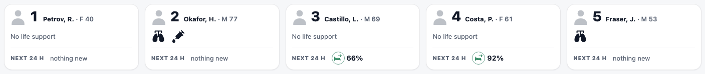 |

**What.** "No life support" and "nothing new" are regular weight, not semi-bold, so the icons and percentages carry the tile. The hairline now sits at the same height on every tile in a row (it moved by 3 px between tiles with and without a circle). No information was removed.

**Why.** Q6a: reduce clutter where it does not remove information.

**Undo.** `.nowl .mu` and `.nextl .mu` back to `font-weight:600`; `.nowl` `min-height` back to `1.75rem` and `.nextl` to `1.875rem`.

### 6. "Update the unit" shows its progress

| Before | After |
|---|---|
| 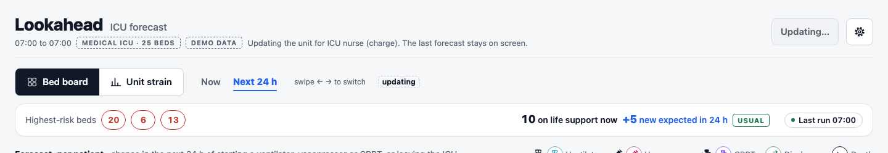 | 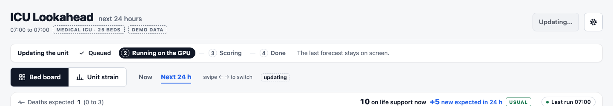 |

Done, stopped, and on a phone:

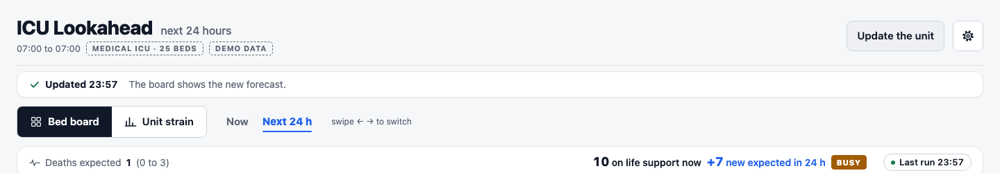

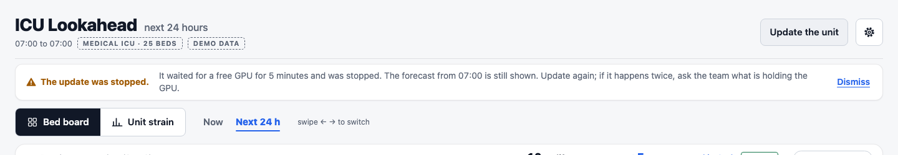

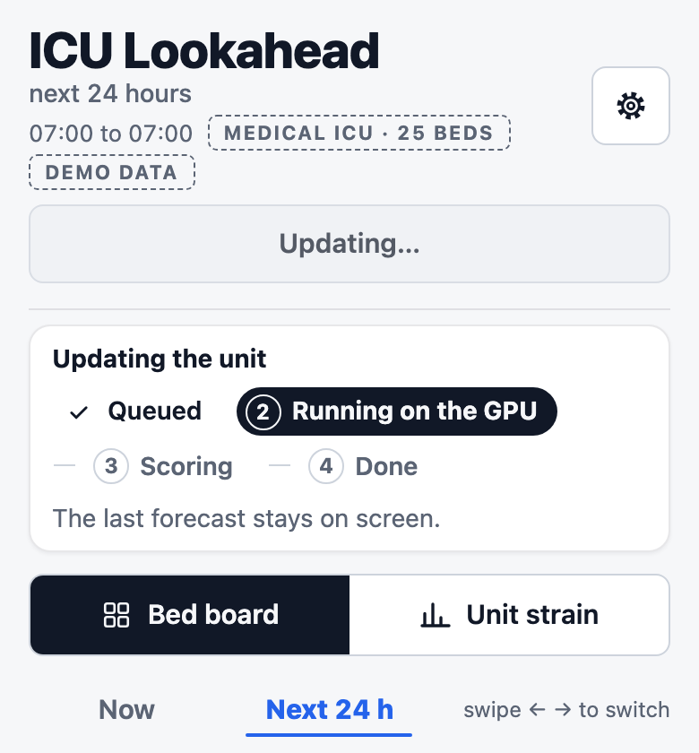

**What.** A strip under the header shows four steps: Queued, Running on the GPU, Scoring, Done. When the new forecast lands, the cards take one short blue ring and the strip reads "Updated 07:42 · The board shows the new forecast." for 8 seconds. Failures stay until dismissed and say what happened and what to do: "Not started." with the server's reason; "The update was stopped. It waited for a free GPU for 5 minutes…"; "No new forecast arrived. …". The same strip shows inside an open bed for "Update this bed".

**How it knows.** Served live, the step comes from `GET /api/runs`, now read every 10 seconds while a run is going (it was 30; the dispatcher caches its job list for 10 seconds, so this adds no cluster calls). `running.state` `PENDING` is Queued; any other running state is Running on the GPU; when the job has left the list and the files have not landed yet, Scoring. `/api/runs` has no separate scoring state. If the team wants the step to be exact, the dispatcher would need to report the job's stage; that is a backend change and is not made here.

**Why.** Q6b. Before, the only signs were the button reading "Updating…" and a small "updating" tag, and a failed run ended in "The numbers have not changed yet."

**Needs a live check.** The strip is tested in a real browser with made-up data and against a stand-in dispatcher that walks through PENDING, STARTED, finished and stopped (`test_a_live_update_follows_the_dispatcher_and_ends_updated_or_stopped`). It has not been watched against a real Fuzzball run.

**Undo.** Remove the block from `const STEPS` to `flashFresh`/`setProg`, the two `#runprog` / `#rv-prog` elements, and the `.runprog`, `.steps`, `.pg-*` and `fresh` CSS; restore the three `say2(...)` lines in `startUpdate` and the old `if(run && !busy)` block in `pollRuns` (both are in the diff of this pull request).

### 7. Chat: clearer suggested questions

| Before | After |
|---|---|
| 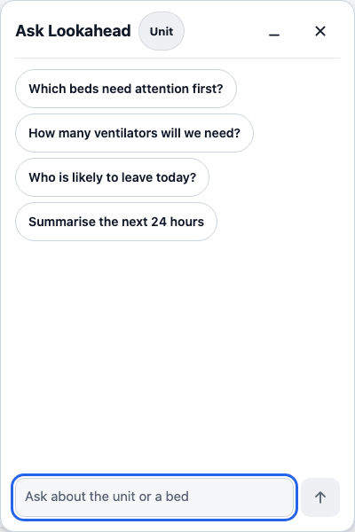 | 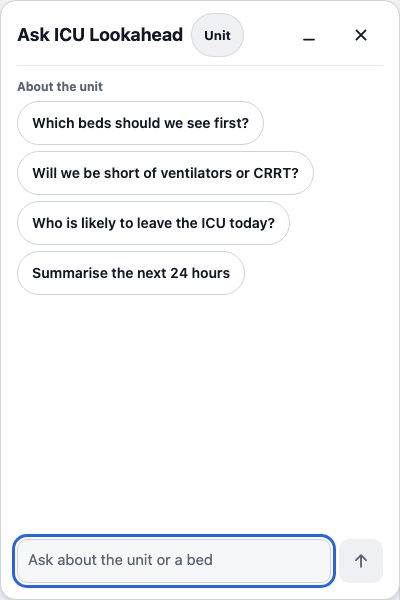 |

| Before | After |
|---|---|
| 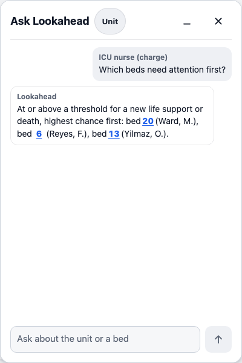 | 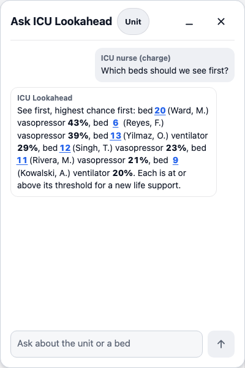 |

**What.** The suggested questions sit under a small label, "About the unit" or "About bed 20", and name the bed they are about.

| Context | Before | After |
|---|---|---|
| Unit | Which beds need attention first? | Which beds should we see first? |
| Unit | How many ventilators will we need? | Will we be short of ventilators or CRRT? |
| Unit | Who is likely to leave today? | Who is likely to leave the ICU today? |
| Unit | Summarise the next 24 hours | Summarise the next 24 hours |
| Bed | Why is this bed flagged? | Why is bed 20 flagged? |
| Bed | What changed in the last 12 hours? | What did the model read for bed 20 in the last 12 hours? |
| Bed | Chance of leaving the ICU? | How likely is bed 20 to leave the ICU? |

Bed numbers in an answer were already links; they open the bed pop-up, and the "see first" answer now gives each bed's event and chance. Served live, the questions go to Nemotron as typed; the wording of live answers is the chat agent's and is unchanged.

**Why.** Q6c.

**Undo.** Restore `UNIT_Q` and `roomQ`, remove the `chipl` label in `renderChips`.

### 8. Chat opens above an open bed (bug fix)

| Before | After |
|---|---|
| 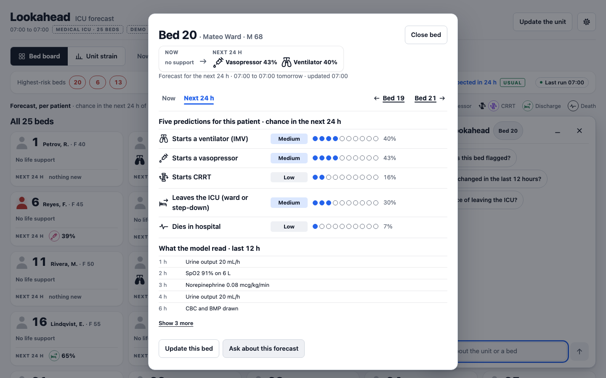 | 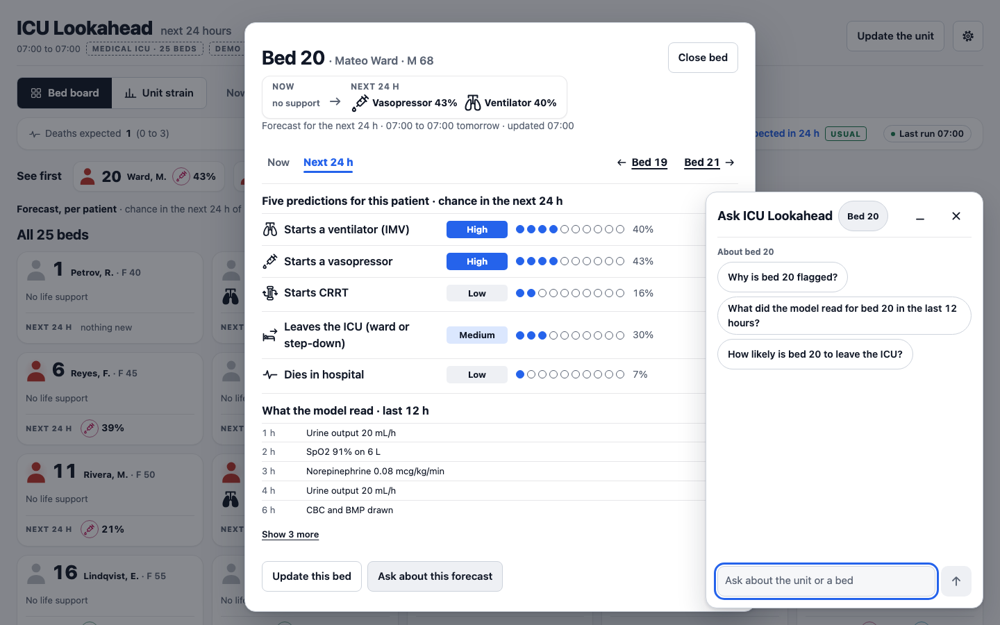 |

**What.** "Ask about this forecast" inside a bed opened the chat under the pop-up's grey layer, where it could not be clicked on a desktop. The chat now sits above an open bed.

**Undo.** `.chatbtn` `z-index` back to 20 and `.chatpanel` to 21.

### 9. Escape closes one panel at a time (bug fix)

**What.** With Settings open over a bed, one Escape closed both. Now the first closes Settings and the second closes the bed. From PR 24. No picture: nothing looks different.

**Undo.** Remove `e.preventDefault()` in the Settings key handler and `&& !e.defaultPrevented` in the bed's.

### 10. 44 px touch targets

Pictures: change 3, the chips in the alert line.

**What.** The highest-risk bed chips were about 41 by 32 px and the "Change" links about 31 px high. Both are now at least 44 px. From PR 24.

**Undo.** `.bedchip` `min-width:2.5rem;min-height:2rem`; `.chg` without `display`, `min-height` and the `-.75rem` margins.

### 11. Header reads "ICU Lookahead"

Pictures: change 1.

**What.** The title is "ICU Lookahead" with "next 24 hours" beside it (it was "Lookahead · ICU forecast"). The browser tab and the chat ("Ask ICU Lookahead") follow.

**Why.** D24.

**Undo.** The `<h1>`, `<title>`, `document.title` and the three "Ask ICU Lookahead" strings.

### 12. Phone layout at 390 px

| Before | After |
|---|---|
| 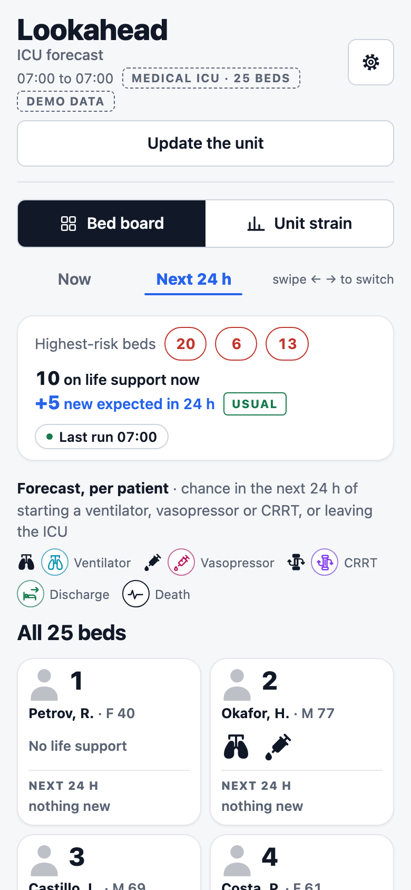 | 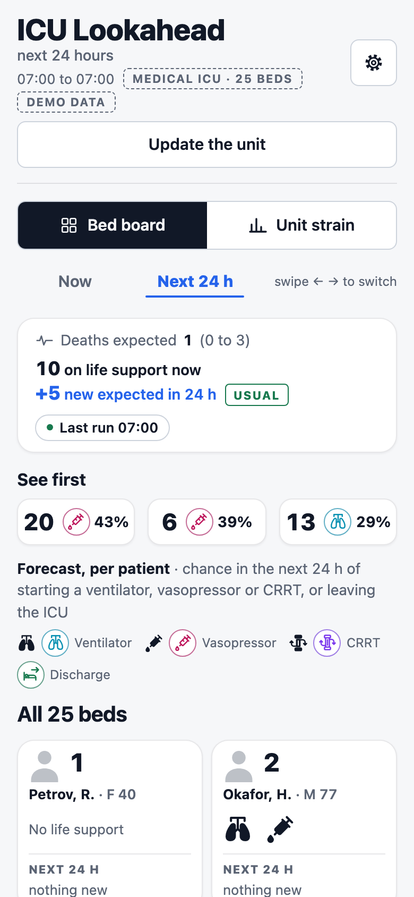 |

**What.** See first is three across on a phone (bed number, event icon, chance). The progress strip wraps its steps under its title. No sideways scroll at 390 px on either tab, in Now and Next 24 h, day and night.

### 13. No console error when no context is published

**What.** On every load the page asks the server for `/api/context`. A board started without `--context` answered 404, which the browser logs as a failed request. The server now answers `200 {"available": false, "context_mode": false}` and the page reads the two plain files as before. The page still accepts the 404 of an older server, so it works on ICU-Twin's `board.py` unchanged (with the one console line).

**Undo.** `backend/app/board.py`: the `/api/context` line back to 404. The page needs no undo.

### 14. Standard flag lines 20% / 40% / 60% and "Reset to standard"

| Before | After |
|---|---|
| 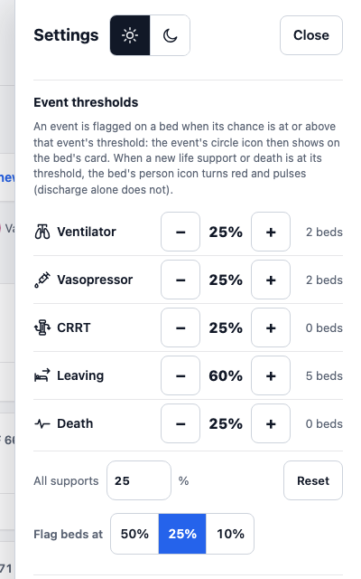 | 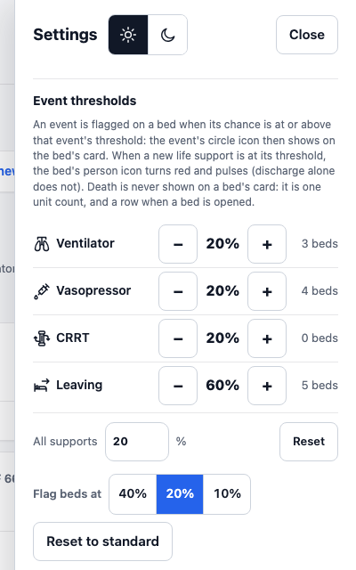 |

**What.** The default "Flag beds at" is 20% (it was 25%), the presets are 40 / 20 / 10 (they were 50 / 25 / 10), High on an opened bed's rows starts at 40% (it was 50%), and a visible "Reset to standard" beside the presets returns every line to the standard. Leaving stays 60%. Dema's per-event steppers are unchanged. A threshold saved on a device earlier is kept until "Reset to standard" is pressed.

**What it changes on screen.** With the made-up data the 20% line flags 6 beds where 25% flagged 3, the Ventilator card counts 3 beds (it was 2) and the unit with six ventilators reads "short by 2" (it was 1). The three See first beds are the same: that row does not depend on the line.

**Why.** D13 and D14 set the board's thresholds at 20% (watch), 40% (worsening) and 60% (leaving); D26 makes them the page's defaults. This is no longer a proposal: J.C. merged PR 24 on 2026-11-15.

**Undo.** `LINE_DEF` back to `.25`, `upLine` back to `[.25,.5,.75]`, the three preset buttons back to 50 / 25 / 10 (and `[50,25,10]` in `paintFlag`), and remove the `flag-reset` button and its handler.

## 3. Proposals not applied

These would change Dema's settings or the design system, so they are listed, not made.

| # | Proposal | From | What it would change |
|---|---|---|---|
| A | (was: default flag lines 20% / 40% / 60%) | PR 24, D26 | **Applied**, no longer a proposal: change 14 above |
| B | The page's blue | DESIGN.md | The page uses `#2563EB` (night `#8DBBFF`); DESIGN.md's `blue` token is `#1E5BB8`. They are visibly different, so the page was left alone. Either record `#2563EB` in DESIGN.md as the board's blue, or move the page to the token |
| C | Three type sizes off the scale | DESIGN.md | `.6875rem` (capitals labels: NEXT 24 H, status chips), `1.25rem` ("All 25 beds", "How this forecast was made") and `2.25rem` (the lead number in Now). The nearest tokens are `.75rem`, `1.125rem` or `1.375rem`, and `2rem` or `2.5rem`; each differs by 1 px or more, so none was changed. Either add the three sizes to DESIGN.md or move the page |
| D | One radius off the scale | DESIGN.md | `2px` on the underline of the Now / Next 24 h switch. Add to DESIGN.md or use `.125rem` (the same at 16 px) |
| E | A status word on a flagged tile | Impeccable audit (WHAT_WE_FIXED.md) | A flagged tile carries an icon, a percentage and a red figure, but no word. The status words were retired in D22/D25, so adding one is a design decision |
| F | An exact "Scoring" step | change 6 | The dispatcher would report the running job's stage in `/status` |

The Impeccable detector reports no anti-pattern on the page. Its five advisory notes are B, C and D.

## 4. Port to ICU-Twin

Do this only for what was approved above. ICU-Twin is the repo the demo runs from; nothing in this section has been done.

### 4.1 The page

The page is one file, and every change in section 2 is inside it.

```bash
# from an ICU-Twin checkout, on a new branch
cp ../icustrainciq/mockups/command-center.html app/static/index.html
```

To review it as a diff first: [`patches/icu-twin-page.patch`](patches/icu-twin-page.patch) is ICU-Twin `fac343d` `app/static/index.html` against this page (`git apply docs/patches/icu-twin-page.patch` from the ICU-Twin root). It also carries the layers this repo already had on `main` (unknown support stays unknown, "no data" for a skipped event, machine totals from the server; [`ICU_TWIN_DELTA.md`](ICU_TWIN_DELTA.md)).

The page runs on ICU-Twin's `app/board.py` and `app/dispatcher.py` as they are: they already serve `/api/runs` with `running.state` and `stuck`, which is all the progress strip reads. Two things differ there and both are harmless: `/api/context` answers 404 (one line in the console; the page then reads the two files), and `/api/capacity` has no machine totals (the page keeps them on the device).

To undo one change before porting, revert it here first (section 2), then copy.

### 4.2 Four small fixes for ICU-Twin before the demo

| # | Fix | File in ICU-Twin | How |
|---|---|---|---|
| 1 | Drop non-finite vital signs. A NaN or infinite reading makes an hourly median non-finite, and `rooms.json` is then not valid JSON, so the board shows no rooms | `app/clif_now.py`, `vitals_before_cut` | [`patches/icu-twin-clif-now-vitals.patch`](patches/icu-twin-clif-now-vitals.patch): filter `vital_value` with `is_finite()` before the median, and skip a non-finite median when writing. `app/rooms.py` needs no change: it passes the result through. Test here: `test_vitals_before_cut_leaves_out_non_finite_readings` in `backend/tests/test_clif_now.py` |
| 2 | A skipped event reads "no data", never 0 | `app/static/index.html` | Comes with the page (4.1): `naq`, `vqn`, and the `na` branches of the event cards |
| 3 | Death is out of the risk ranking. ICU-Twin ranks the three highest-risk beds with `RISKK = ["death","imv","vasopressor","crrt"]` | `app/static/index.html` | Comes with the page (4.1). If the page is not taken, the one-line fix is `const RISKK = ["imv","vasopressor","crrt"];` |
| 4 | The demo script matches the final page | `docs/submission/DEMO_SCRIPT.md` | Copy [`submission/DEMO_SCRIPT.md`](submission/DEMO_SCRIPT.md) from this repo: its clicks follow this page (See first, the progress strip, the new chat questions). Speaker and driver are still `[FILL]` |

After porting: `uv run --extra dev --extra model pytest -q` in ICU-Twin, open the board at 1440 px and 390 px, press "Update the unit" once on the cluster and watch the strip (the live check in change 6).
