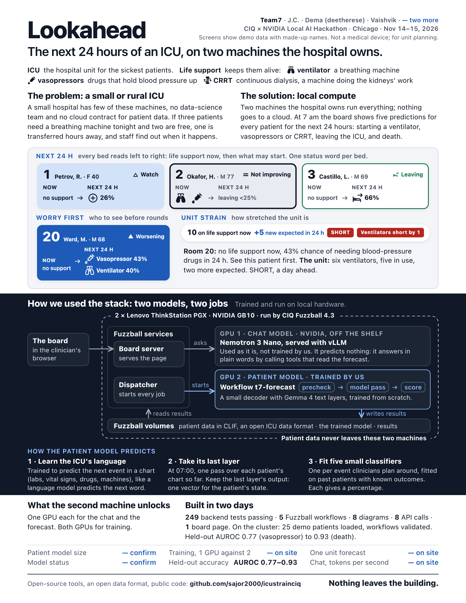

# Lookahead: hackathon submission

Team7, CIQ × NVIDIA Local AI Hackathon, Chicago, Nov 14–15, 2026.

| File | What it is |
|---|---|
| [`one-sheet.pdf`](one-sheet.pdf) | The one-page summary, US Letter, print-ready |
| [`one-sheet.png`](one-sheet.png) | The same page as an image |
| [`one-sheet.html`](one-sheet.html) | The source of the page (edit this) |
| [`DEMO_SCRIPT.md`](DEMO_SCRIPT.md) | The five-minute demo: clicks, words, fallback plan |
| [`FILL_IN.md`](FILL_IN.md) | Every number still to be measured, and who supplies it |
| [`make_shots.py`](make_shots.py) | Regenerates the screenshots in `img/` and exports the PDF and PNG |



## Regenerate

```bash
# screenshots from the board (demo data) + PDF + PNG
uv run --with playwright python docs/submission/make_shots.py

# only the PDF and PNG, after editing one-sheet.html
uv run --with playwright python docs/submission/make_shots.py export
```

First run on a new machine: `uv run --with playwright playwright install chromium`.

The screenshots come from `mockups/command-center.html#synthetic`: made-up patients generated on the page. No patient data is read.
